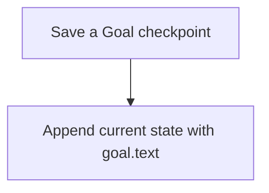
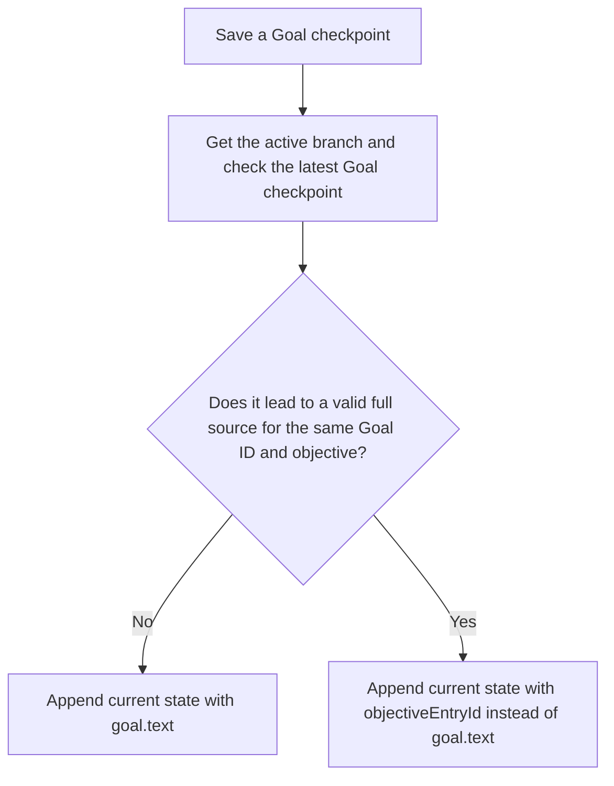
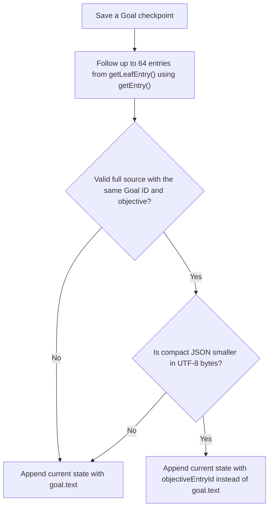
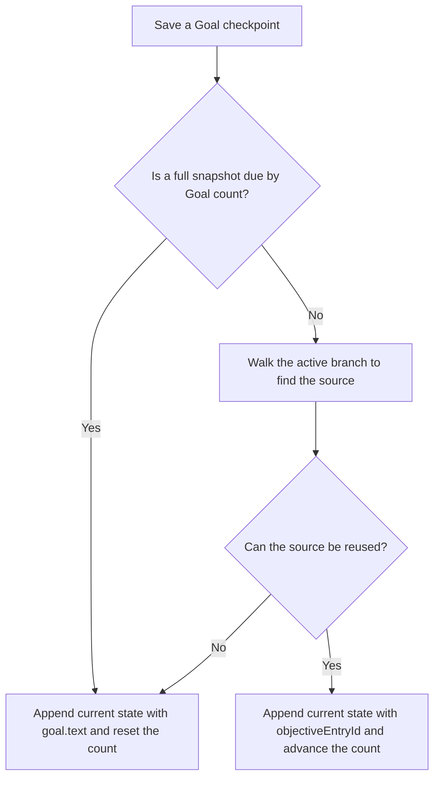
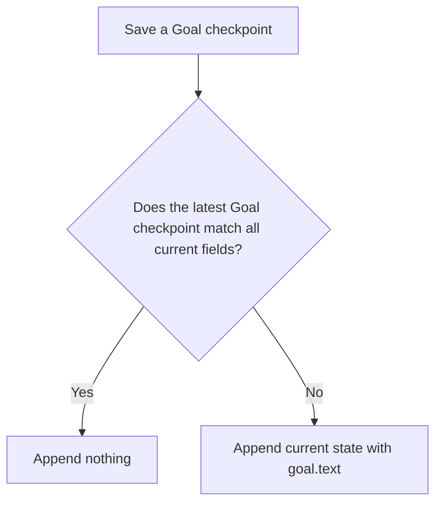
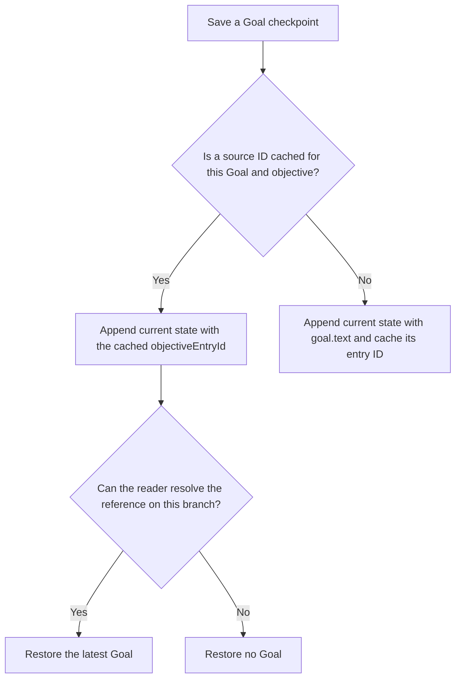
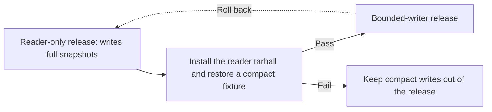

# ADR: Bound objective reference lookups in Goal checkpoints

## Status

Accepted as the design for a follow-up. The writer is not implemented or released.

## Context

Pi Goal stores the full objective in each `goal-state` checkpoint, even when only status or usage changes. Pi reads the session JSONL file on reopen, so repeated objectives add data to both writes and subsequent reads.

[PR #2066](https://github.com/narumiruna/pi-extensions/pull/2066) shows how direct references reduce file size, but its writer can scan the same growing branch on every write. A reader that requires `goal.text` cannot restore a compact checkpoint at the branch tip. [PR #2071](https://github.com/narumiruna/pi-extensions/pull/2071) adds the reader and keeps writing full snapshots so that the two changes can ship separately.

## Decision

Use **bounded direct references with a size check**. Keep the current accounting and status in every checkpoint. Omit `goal.text` only when a full snapshot on the active branch already stores the same Goal ID and exact objective, and the compact JSON is strictly smaller in UTF-8 bytes. Write the full snapshot's entry ID in `objectiveEntryId`; do not chain references to other compact checkpoints.

- Start with Pi's `getLeafEntry()` and follow `parentId` with `getEntry()`. Do not call `getBranch()` on the write path. Inspect no more than 64 existing session entries, including entries unrelated to Goal.
- Accept a source only if the current reader can resolve the same path. Do not cross a clear, another Goal, an objective edit, or an invalid checkpoint. Use a full snapshot if the APIs are unavailable, a link is missing or cyclic before the source, or the limit is reached without a valid source. The scan relies on Pi's session entry IDs being unique; it is not a validator for the entire session file.
- Keep selection and append synchronous in the same session. Keep `{ goal: null }` for a clear. Do not rewrite existing session files or change the reader format defined in the [continuation lifecycle guide](../../packages/pi-goal/docs/continuation-lifecycle.md#compaction-persistence).

## Considered options

| Method | Storage and write cost | Reason for selection or rejection |
| --- | --- | --- |
| **1. Full snapshots** | Repeat the objective on every checkpoint. No source lookup. | Keep this as the fallback and the #2071 write format. It does not reduce repeated text. |
| **2. Unbounded direct references** | Store one copy over an unchanged run. In #2066, the backward scan alone can visit `N × (N − 1) / 2` entries over `N` consecutive Goal checkpoints. | Reject the unbounded write path. It can also write a compact record when a reference costs more bytes than a short objective. |
| **3. Bounded direct references with a size check** | Search at most 64 existing session entries. Store a new full snapshot when the last source falls outside the window. | Select. It preserves every checkpoint and saves space only when the reference reduces the encoded size. |
| **4. Periodic full snapshots counted only by Goal checkpoints** | Limit the number of compact Goal checkpoints between full snapshots. | Reject as a write-time bound. Any number of messages or other session entries can fall between two Goal checkpoints, so the parent walk is still unbounded. |
| **5. Skip identical checkpoints** | Save space only when the persisted state is identical. | Reject as the main solution. A change in usage or status still writes the objective again. Skipping also removes a distinct saved point from the branch history. |
| **6. Reuse a cached source ID without checking ancestry** | Avoid a parent walk on a cache hit. | Reject an unchecked cache: a fork or clear can leave the cached ID unusable. A branch-aware cache could work, but it would add state and invalidation rules that the bounded scan does not need. |

### Write flows

Each flow starts when Goal saves a checkpoint. The flows do not show explicit clears.

#### 1. Full snapshots

Write the complete state without looking up an earlier checkpoint.

#### 2. Unbounded direct references

PR #2066 searches the active branch without a fixed limit. It does not compare encoded sizes.

#### 3. Bounded direct references with a size check

The selected design writes a reference only if it finds a valid source within the limit and the compact record is smaller.

#### 4. Periodic full snapshots counted only by Goal checkpoints

Refresh the full snapshot at a fixed Goal checkpoint count. Between refreshes, the count does not bound the parent walk.

#### 5. Skip identical checkpoints

Skip the write only if the entire persisted state matches the latest checkpoint on the active branch.

#### 6. Reuse a cached source ID without checking ancestry

A cache hit skips the parent walk, but the source may no longer be usable after a fork or clear.

## Consequences

With 450 consecutive Goal checkpoints for the same 2,000-byte objective and no intervening records, the model stores seven full objectives and 443 references. This reduces raw objective text from 900,000 to 14,000 bytes, before reference and JSON overhead. The result assumes each reference is smaller than its full snapshot. It is not a file-size measurement or a latency result. Interleaved records can require more full snapshots.

The bound caps history lookups, not write time. The writer spends time on a bounded scan and size comparison; it may write fewer bytes. Reopening a smaller file may reduce read and parse time, but Goal must still resolve a compact checkpoint. Measure both paths before claiming a speed improvement.

## Rollout and rollback

Release the reader and writer separately. Do not publish a compact writer until the reader-only package is available from npm and its actual tarball restores a compact fixture with the correct objective and accounting. The reader-only package must still write full snapshots.

The reader release is the supported rollback target for the writer, including after an abrupt stop. A release from before the reader cannot restore a compact branch tip just because an earlier full snapshot exists. To use such a release, first reopen or fork the intended branch with the reader-only package and let it save the unfinished Goal in full. Earlier compact branch points still need a compatible reader.

## Verification for implementation

1. Use the same input events for the full and compact writers. Measure the new JSONL bytes, maximum parent lookups per append, and write and reopen latency. Include short text, escaped text, long unchanged text, and interleaved non-Goal entries.
2. Test the exact 64-entry boundary, edits, clears, forks, missing or cyclic parents, and the full-snapshot fallback. Restore each selected checkpoint with Pi's package loader and check the objective, status, and accounting.
3. Verify rollback with the published reader-only tarball. Test checkpoints on both sides of a full-snapshot refresh, including a compact branch tip from an abruptly stopped session.

The Lean model verifies the lookup bound, the encoded-size guard, and restore on a valid branch. It does not verify the TypeScript implementation, Pi's parent lookup behavior, JSON serialization, or elapsed time. Those checks remain release prerequisites.
