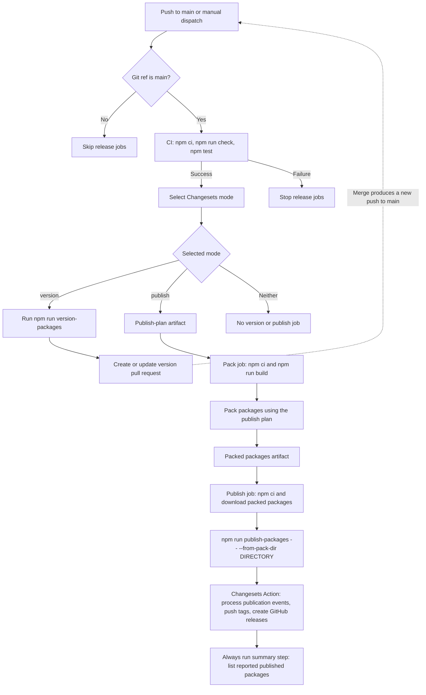

# Publish workflow

[`.github/workflows/publish.yml`](../.github/workflows/publish.yml) versions or publishes packages after CI passes. It starts on a push to `main` or a manual dispatch. Jobs run only for `main`. Runs are serialized for each Git ref without cancelling an active release run.

## Jobs

| Job | Purpose |
| --- | --- |
| `checks` | Call `ci.yml` to build, check, and run affected tests; test selection can fall back to the full suite. |
| `select-mode` | Select version, publish, or neither with the Changesets Action. |
| `version` | Update versions and the lockfile, then create or update the version pull request. |
| `pack` | Build packages and pack the selected publish plan into an artifact. |
| `publish` | Download the artifact and invoke native Changesets artifact publication with npm provenance enabled. |

Each non-CI job checks out the repository, sets up Node.js, and runs `npm ci`. The publish job does not repeat CI checks or tests.

## Publication and failures

`publish-packages` invokes `changeset publish`. Native Changesets uses the packed dependency chunks. There is no custom Kit-first ordering, registry-readiness polling, or post-publication tarball verification.

Publication is not atomic. A failed run can leave some packages published. The Action processes reported publication events, but tag or GitHub release operations can also fail. The summary step runs even after a failure and writes a table only when the Action returns published packages; an empty summary does not prove that nothing was published.

See [coordinated releases](coordinated-releases.md) for dependency versioning and recovery limits.
