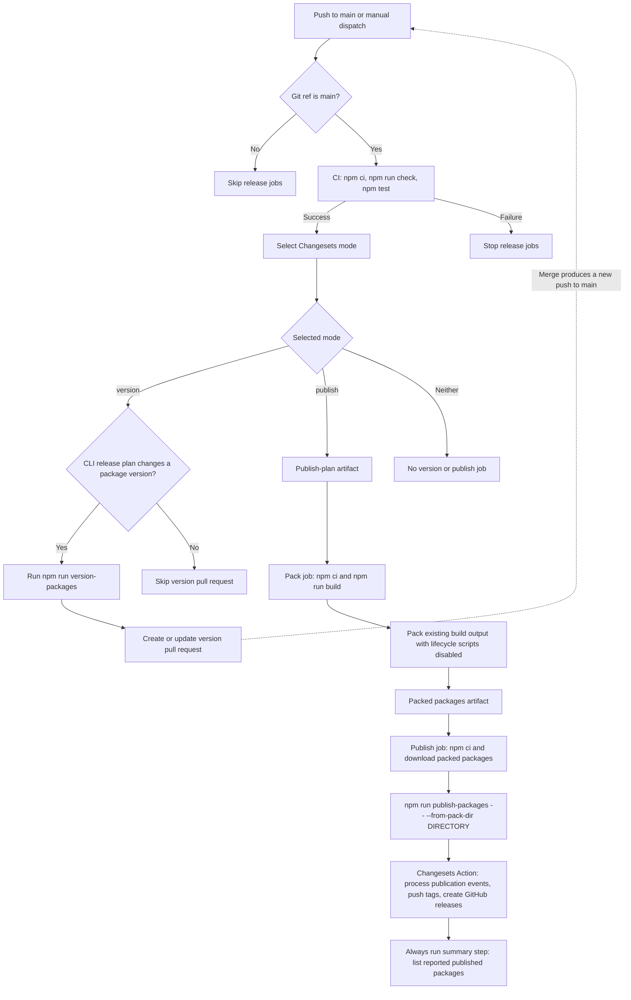

# Publish workflow

[`.github/workflows/publish.yml`](../.github/workflows/publish.yml) versions or publishes packages after CI passes. It starts on a push to `main` or a manual dispatch. Jobs run only for `main`. Runs are serialized for each Git ref without cancelling an active release run.

## Jobs

| Job | Purpose |
| --- | --- |
| `checks` | Call `ci.yml` to build, check, and run affected tests; test selection can fall back to the full suite. |
| `select-mode` | Select version, publish, or neither with the Changesets Action. |
| `version` | Check the effective release plan; if a package version would change, update versions and the lockfile, then create or update the version pull request. |
| `pack` | Build packages and pack the selected publish plan into an artifact. |
| `publish` | Download the artifact and invoke native Changesets artifact publication with npm provenance enabled. |

Each non-CI job checks out the repository, sets up Node.js, and runs `npm ci`. The publish job does not repeat CI checks or tests.

Before the version action, `scripts/check-version-plan.mjs` reads the CLI's `changeset status --output` plan. The action runs only when at least one planned `newVersion` differs from its `oldVersion`. This prevents empty release PRs when pending changesets target only private or ignored packages that Changesets will not version. Plan errors fail the job. A skipped plan leaves changesets pending and does not enable publishing.

The pack job completes `npm run build` before packing. Only the **Pack packages** step sets `NPM_CONFIG_IGNORE_SCRIPTS=true`, so native Changesets packs the existing output without running `prepack`, `prepare`, or `postpack` hooks. Changesets can pack dependencies and consumers concurrently; a second Kit build can delete `dist` while a consumer compiles against it. Dependency installation and the explicit build keep their normal script behavior. Package-level hooks remain available for direct `npm pack` commands.

## Publication and failures

`publish-packages` validates the packed plan and invokes native `changeset publish` for dependency-ordered chunks. Before a dependent chunk, the guard requires exact registry metadata and verifies its dependency tarballs against registry integrity and any packed hashes. Each dependency has one 30-second readiness budget shared by metadata queries, tarball fetches, body reads, and retry waits. Temporary failures wait up to two seconds within the remaining budget. Expiry cancels registry I/O and blocks consumers; registry subprocess termination has a separate one-second escalation grace before closure. Native publication remains outside this budget. Authentication, metadata validation, and integrity failures stop immediately. There is no package-specific Kit-first rule; the installed Changesets runtime dependency graph determines ordering. See [coordinated releases](coordinated-releases.md) and [registry diagnostics](publish-registry-diagnostics.md) for verification and retry limits.

Publication is not atomic. A failed run can leave some packages published. The Action processes reported publication events, but tag or GitHub release operations can also fail. The summary step runs even after a failure and writes a table only when the Action returns published packages; an empty summary does not prove that nothing was published.

See [coordinated releases](coordinated-releases.md) for dependency versioning and recovery limits.
