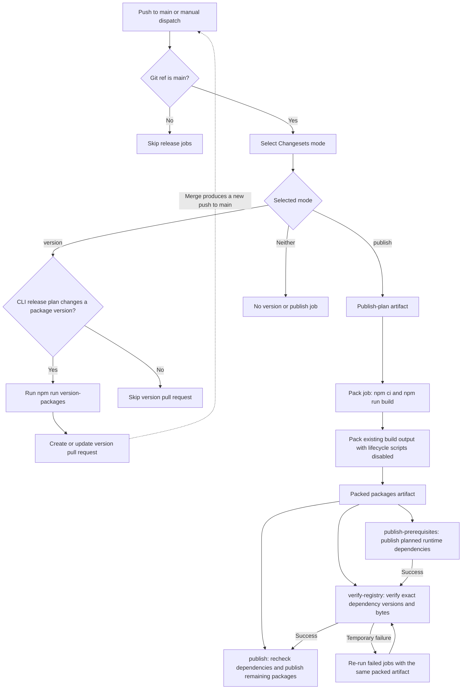

# Publish workflow

[`.github/workflows/publish.yml`](../.github/workflows/publish.yml) versions or publishes packages without rerunning CI checks or tests. It relies on successful PR checks before merge and starts on a push to `main` or a manual dispatch. Jobs run only for `main`. Direct pushes and manual release runs do not have a CI gate in this workflow. Runs are serialized for each Git ref without cancelling an active release run.

## Jobs

| Job | Purpose |
| --- | --- |
| `select-mode` | Select version, publish, or neither with the Changesets Action. |
| `version` | Check the effective release plan; if a package version would change, update versions and the lockfile, then create or update the version pull request. |
| `pack` | Build packages and pack the selected publish plan into an artifact. |
| `publish-prerequisites` | Invoke native Changesets for entries required by another planned package. |
| `verify-registry` | After `publish-prerequisites` succeeds, verify the exact runtime dependencies of the remaining entries without publishing. |
| `publish` | After `verify-registry` succeeds, recheck those dependencies and invoke native Changesets for the remaining entries. |

Each job checks out the original event commit, sets up Node.js, and runs `npm ci`. No job calls `ci.yml` or runs `npm run check` or `npm test`. The three jobs after `pack` download the same artifact from the current run by the ID from `pack`, even across attempts. Missing IDs and download failures stop the job; it does not select another artifact or repack.

Before the version action, `.github/scripts/check-version-plan.mjs` reads the CLI's `changeset status --output` plan. The action runs only when at least one planned `newVersion` differs from its `oldVersion`. This prevents empty release PRs when pending changesets target only private or ignored packages that Changesets will not version. Plan errors fail the job. A skipped plan leaves changesets pending and does not enable publishing.

The pack job completes `npm run build` before packing. Only the **Pack packages** step sets `NPM_CONFIG_IGNORE_SCRIPTS=true`, so native Changesets packs the existing output without running `prepack`, `prepare`, or `postpack` hooks. Changesets can pack dependencies and consumers concurrently; a second Kit build can delete `dist` while a consumer compiles against it. Dependency installation and the explicit build keep their normal script behavior. Package-level hooks remain available for direct `npm pack` commands.

## Publication and failures

The installed Changesets runtime dependency graph determines ordering; there is no Kit-specific rule. The read-only gate has five minutes per exact dependency version, with waits of up to five seconds. Both publishing jobs check dependencies with the existing 30-second budget and waits of up to two seconds. The final check also protects a final-job-only rerun: gate success proves availability at the time of the check, not continued availability. An empty prerequisite stage succeeds without invoking native publication, and a gate with no dependencies makes no registry requests. See [coordinated releases](coordinated-releases.md) for stage commands and [registry diagnostics](publish-registry-diagnostics.md) for exact checks and cancellation.

Both publishing jobs use the pinned Changesets Action with npm provenance enabled. The Action processes native publication events, pushes tags, and creates GitHub releases. Each job summarizes the packages the Action reports, even if the job failed. Publication is not atomic, and an empty summary does not prove that nothing reached npm.

If the gate fails on temporary registry availability, use **Re-run failed jobs** on the same run while the packed artifact is retained. GitHub keeps the original commit and successful job outputs; `pack` and `publish-prerequisites` do not rerun for this failure. For other failures, see the [recovery matrix](release-workflow.md#failures-and-recovery).
