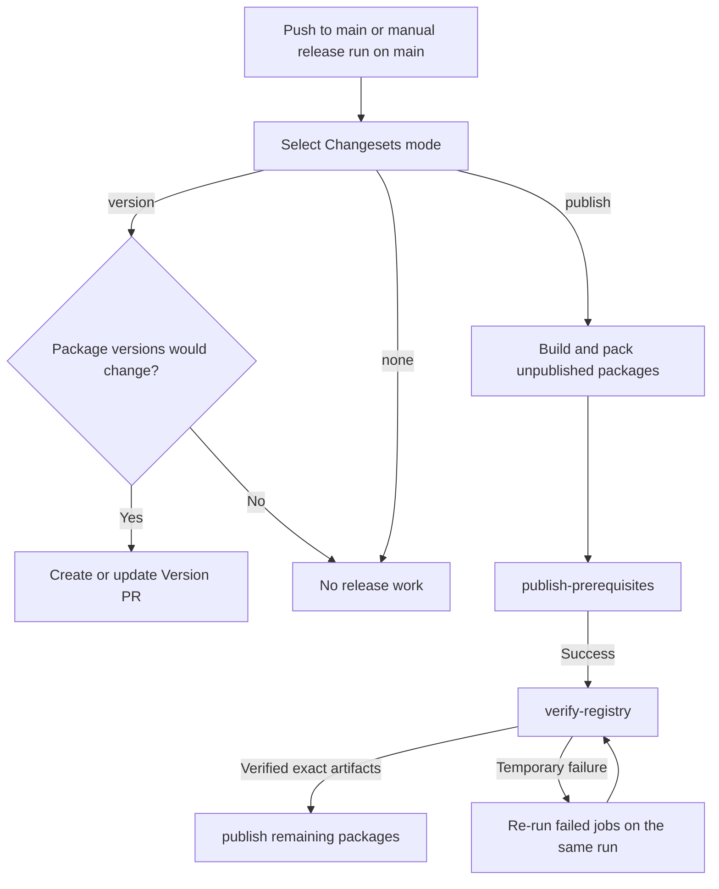

# Release workflow

Main pushes and manual release runs on main run `.github/workflows/publish.yml`; manual runs on other branches skip release work. Release runs start with Changesets mode selection and do not call CI or rerun checks and tests. Pull requests and manual CI runs use `.github/workflows/ci.yml`. Require successful PR checks before merging; direct pushes and manual release runs do not have a CI gate in the release workflow.

Changesets selects `version` when there are non-empty pending changesets, including changesets for packages excluded from versioning. Before the Version PR action, `.github/scripts/check-version-plan.mjs` runs `changeset status --output` and permits the action only if the plan changes a package version. Private-only changesets with `privatePackages.version: false`, ignored-only changesets, and other no-op plans skip PR creation and updates. Plan failures fail the job instead of permitting a PR. Skipped changesets remain pending; the guard does not switch to publishing.

Merging a Version PR consumes its versioned changesets and updates manifests, changelogs, and the lockfile. The next main push selects `publish` if no pending changesets remain and unpublished package versions exist. Empty-only changesets or no unpublished versions select `none`.

## Permissions and authentication

Workflow permissions default to none. Mode selection, packing, and `verify-registry` have only repository read access. The gate has no npm or release credentials. Versioning has repository and pull-request write access and uses `PAT_TOKEN` so the generated PR triggers CI. Version commits are signed through the GitHub API. Only `publish-prerequisites` and `publish` have `id-token: write` for npm Trusted Publishing and provenance, with repository write access for tags and GitHub releases. Neither publishing job uses the PAT.

Keep npm trusted-publisher bindings pointed at this repository's `publish.yml`. All release jobs disable persisted checkout credentials and dependency caches. Checks and tests run in PR CI, not in this workflow. The pack job builds packages in dependency order in its fresh runner, including local build prerequisites that are not runtime dependencies. For example, it builds the daemon before [packing Pi Sync](coordinated-releases.md#pi-sync-and-the-daemon) even though publishing Pi Sync does not require a standalone daemon artifact. All three jobs after `pack` install dependencies without rebuilding packages and use the same packed artifact ID at the original commit. See the [publish job graph](publish-workflow.md#jobs).

## Failures and recovery

The [packed guard](coordinated-releases.md#publication) stops on artifact-verification or native-publication failure. The Changesets Action processes publication events even if the native command fails. If tag pushes or GitHub Release creation fail, inspect the Action logs: the summary may be empty even when packages reached npm.

| Failure | Recovery |
| --- | --- |
| `verify-registry` times out waiting for exact metadata or a tarball | Inspect the exact version and error. Use **Re-run failed jobs** on the same run if the artifact is retained. This reruns the gate and its dependent publish job, not the successful `pack` or `publish-prerequisites` jobs. Do not bypass the gate. |
| Authentication, invalid metadata, or integrity failure | Stop and investigate the immutable plan, npm version state, tags, and GitHub Releases before retrying. Do not change bytes under an existing version. |
| Native publication, tag, or release failure | Inspect npm versions, tags, releases, and logs before deciding whether to replay. A replay can submit already-published versions; it cannot overwrite them and does not repair missing tags or releases. |
| Packed artifact missing, expired, or mismatched | Stop. Never fall back to a different artifact. If publication is still intended, an approved fresh run can recompute the plan from current npm state and repack pending versions. |

A fresh run does not repair missing tags or releases for versions that already reached npm. Inspect and repair them separately with explicit approval. Do not dispatch a release run or merge this release-tooling change just to validate it; either action can publish packages.

For the official architecture and APIs, see [Automating Changesets](https://changesets.dev/guide/automating) and [Changesets GitHub Action](https://github.com/changesets/action). The workflow pins all Changesets sub-actions to the same audited revision.
