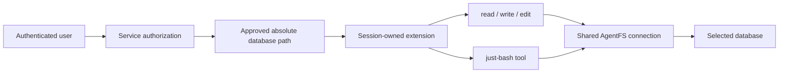
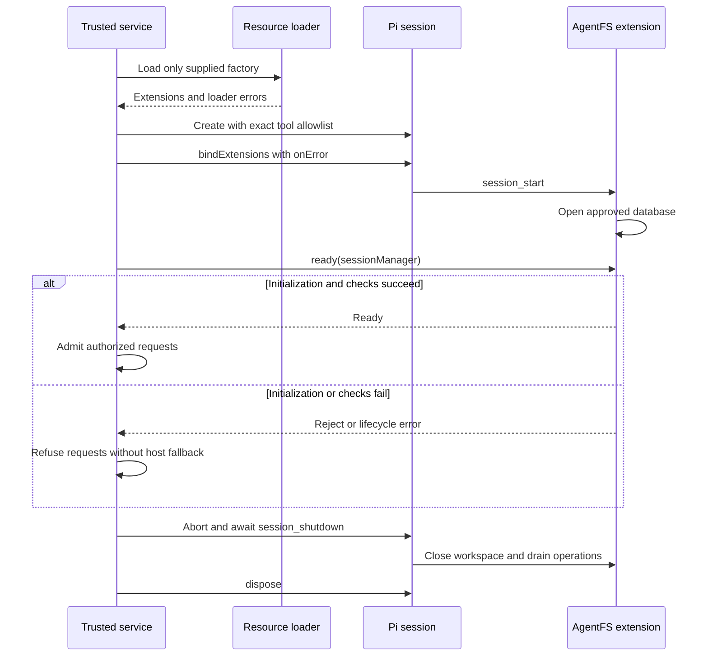

# Service integration

The service authorizes a host database path, then gives one Pi session access to the files inside that database.
Pi AgentFS controls its four tools. The service controls every other way that data or executable code can enter the Pi process.

## Ownership and paths

The service must authenticate the user and resolve an authorized workspace before it creates the extension.
Do not accept a database path, extension path, or user-to-workspace mapping from model output.
Pass a nonempty absolute database path with no NUL characters. Create and secure its host parent directory first.
The package can initialize a database at that path; it does not create host directory trees.

| Value | Example | Owner |
| --- | --- | --- |
| Host database path | `/srv/agentfs/alice.db` | Trusted service or operator |
| Virtual file path | `/notes/today.txt` | Tool caller within the selected workspace |
| Pi conversation history | In-memory `SessionManager`, or service-owned storage | Service |

The database path is not the virtual root. Virtual paths resolve from `/`, independent of Pi's host cwd and the database's parent directory.
Parent traversal stays within the virtual path namespace. `~` and `~/` mean the virtual root; named home directories and symbolic or hard links are unsupported.
A missing virtual file fails; it does not cause a host filesystem lookup.

One session workspace owns one connection and a queue covering whole `read`, `write`, `edit`, and `bash` operations.
The queue prevents an edit or shell operation from interleaving with another operation on that workspace.
It does not coordinate separate workspace owners or processes. Do not open the same database concurrently through multiple sessions or processes.
Use distinct extension instances and database paths for users that require separate workspaces.

The implemented data path does not authorize users or restrict the surrounding process:



## CLI and RPC startup

Load the package with `-e` and pass `--agentfs-path` on the same invocation.
For example, from a checkout after `npm install` and the root `npm run build`:

```bash
pi --mode rpc --no-extensions -e ./packages/pi-agentfs \
  --no-skills --no-prompt-templates --no-themes --no-context-files --no-approve \
  --no-session --tools read,write,edit,bash \
  --agentfs-path /srv/agentfs/alice.db
```

Omit `--mode rpc` for interactive use. After publication, `-e npm:@narumitw/pi-agentfs` can replace the local package path.
The Pi entrypoint is source TypeScript. SDK imports instead require the package build.

These options do not make the CLI a hardened service. Pi can still use personal `SYSTEM.md`, `APPEND_SYSTEM.md`, credentials, model configuration, and other host features.
Use a controlled agent directory and process environment, and reject unapproved startup inputs.
Do not pass host `@file` attachments or arbitrary system-prompt paths. RPC clients must also restrict session switching, import/export, and other host-facing commands.

The absent flag leaves ordinary Pi behavior unchanged. An empty or relative flag value is invalid, not a request for disabled mode.
When workspace mode is requested, replacements are installed before database initialization; loading, failed, and closed workspaces reject calls without a host fallback.
Pi can catch extension startup errors and keep running. A process that is alive or a successful RPC state response is not proof that the workspace opened.
Treat startup diagnostics and RPC `extension_error` records as service failures; do not admit requests on an unverified session.
For an explicit programmatic readiness barrier, use the SDK factory below.

The extension rejects `user_bash`, including interactive `!` and `!!` and the RPC `bash` command path.
These are not aliases for the AgentFS `bash` tool.

## SDK startup and shutdown

Import the named factory from the package root:

```ts
import { createAgentfsExtension } from "@narumitw/pi-agentfs";

const extension = createAgentfsExtension({ path: approvedDatabasePath });
```

Its interface is:

```ts
createAgentfsExtension(options: { path: string }): ExtensionFactory & {
  ready(sessionManager: object): Promise<void>;
};
```

The factory validates the explicit path and registers replacements without opening the database during factory loading.
Opening starts at `session_start`, emitted by `session.bindExtensions()`.
Readiness is keyed by the owning `sessionManager`, not by `ctx.ui`, which can be shared in headless mode.

Follow the full runnable [service example](../examples/service.ts). It makes no model requests and uses no API key.
From the repository root, with an approved path whose parent already exists:

```bash
npm run build
node --experimental-strip-types packages/pi-agentfs/examples/service.ts /srv/agentfs/alice.db
```

The sample creates the session, checks readiness and tool ownership, and shuts it down without modifying virtual files.
A successful exit means the startup checks passed, not that a real deployment or provider integration was verified.

The sample has these required boundaries:

1. Use in-memory settings, credentials, model catalog storage, and `SessionManager`; disable model catalog network refresh and disk model configuration.
2. Disable discovery of extensions, skills, templates, themes, and context files. Supply the AgentFS factory explicitly.
   - Set a literal `systemPrompt` and `appendSystemPrompt: []`; `noContextFiles` alone does not suppress `SYSTEM.md` and `APPEND_SYSTEM.md`.
3. Use the exact tool allowlist `['read', 'write', 'edit', 'bash']`, not additive selections or the default tool list.
4. Reject resource-loader errors and session loader errors, collect lifecycle errors through `bindExtensions({ onError })`, and await `extension.ready(session.sessionManager)` after binding.
5. Check the active tool names, callable tool names, all registered tools, and that every implementation is the registered AgentFS replacement before admitting service requests.
6. On failure or completion, stop active work, await `session_shutdown`, then dispose the session.
   - In the tested Pi runtime, `session.dispose()` alone does not emit the extension shutdown event.
   - Shutdown closes the connection after active database work drains; it does not delete the database.

The sequence keeps an unready session out of the service request path:



A service must retain lifecycle error handling after startup and stop admitting work if the session fails or closes.
For session replacement or reload, repeat authorization and startup checks for the new owner; do not reuse an old readiness result or extension context.

Never route a request to `session.executeBash()`. This direct SDK method can bypass `user_bash` and execute on the host.
Do not give an untrusted client access to the raw SDK session or allow it to change tools, load extensions, or select arbitrary database paths.

## Shell contract and bounds

The `bash` tool uses `just-bash` with the same AgentFS connection as the file tools.
It starts a fresh interpreter at `/` for every call, with `HOME=/` and `PATH=/usr/bin:/bin` instead of `process.env`.
`PATH` is interpreter configuration, not permission to launch host executables.
Files persist between calls. Changes to cwd, exported variables, shell functions, and other interpreter state do not.

The command allowlist is:

```text
cat cp cut echo false find grep head ls mkdir mv pwd rm sed seq sleep
sort tail tee tr true uniq wc
```

Shell syntax includes pipelines and redirection, but this is not a promise of full GNU Bash or GNU utility compatibility.
Unsupported commands fail. Network commands, host shell processes, package managers, JavaScript/Python executors, and custom host commands are not enabled.

The fixed limits are defined by the tool implementation. They are not service configuration settings.

| Limit | Bound |
| --- | --- |
| Shell timeout | Default and maximum 30 seconds |
| Command source | 64 KiB |
| Interpreter command count | 10,000 |
| Interpreter loop iterations | 1,000 |
| Interpreter output | 1 MiB |
| Model-visible output | At most 50 KiB or 2,000 lines, including truncation notices |

Output beyond the tool bound is truncated; full shell output is not saved to a host temporary file or retained as a separate workspace log.
A nonzero exit, timeout, cancellation, or interpreter limit produces a tool failure, not host execution.
Cancellation and shutdown stop further workspace operations, but file changes that completed before failure are not rolled back.
These bounds are not database storage quotas or an operating-system CPU/memory isolation guarantee.

## Text reader compatibility

The `read` tool implements the text-only path and uses Pi's public truncation helpers.
Pi's complete reader probes host paths before it calls injected read operations, so reusing that complete reader would break the no-host-access requirement.
The extension-owned reader avoids those probes and provides line offsets, limits, continuation notices, and bounded text output through AgentFS only.
It does not provide Pi's image-reading behavior.
`write` and `edit` retain Pi's operations-based text behavior with virtual filesystem adapters.
The adapters pin the original normalized virtual path, so Pi's host-oriented filename transformations cannot select another file.
Unicode spaces, `@` prefixes, and file-URL-looking names are literal virtual filenames; no host-dependent filename guesses are made.

Tool rendering intentionally omits host-file hyperlinks and speculative edit previews because Pi's default edit preview reads host files.
The renderers use only supplied arguments, results, and completed edit diffs. They remove terminal controls from display copies without changing stored filenames or tool payloads.
Display rows use cell-aware hard wrapping. Spaces and blank lines remain in the sanitized text; a grapheme wider than the available row is shown as `?` instead of overflowing the row.
Read paging accepts positive integer offsets and limits, and reserves space for continuation notices within the complete output bound.

## Deployment and publication handoff

The actual chatbot service and its permission system have not been inspected or deployed as part of this package.
Before claiming end-to-end user isolation, the service owner must verify authentication, authorization, database mapping, one-owner database access, session history, attachments, logs, exports, backups, and retention.
Also verify that no alternate tool, MCP server, extension, auto-loaded resource, direct SDK method, or RPC route exposes host data or another user's resources.
Use an operating-system isolation boundary when the threat model requires one; this extension is not that boundary.

The npm name's availability, publication authorization, and trusted publishing setup remain unverified.
Local package preparation is not approval to publish, change visibility, create release tags, or deploy a service.
Review the pinned dependency tree and current advisories before deployment; excluding a shell command does not remove its dependency from an installed package.
The initial dependency audit reports advisories through `guarded-fetch`/`undici` and `sprintf-js`; their network and `printf` command paths are not enabled and have rejection tests.
These packages remain installed dependencies, not audited-safe code. The repository denies install scripts for optional native compression libraries, which this command allowlist does not use.
Do not deploy this MVP as a hostile-code or multi-tenant process security boundary.
