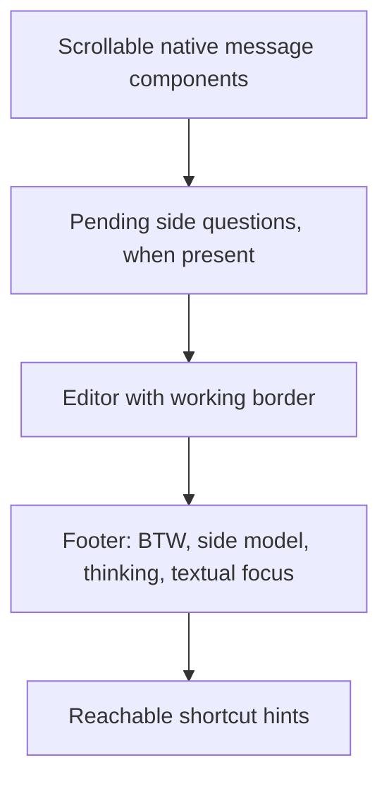

# Native conversation appearance

[README](../README.md) · [Workflows](./workflows.md) · [Core-alignment handoff](./core-alignment.md)

BTW uses Pi's message components and native-style editor geometry, with identity and shortcuts below the editor.
This change is appearance-only: no tools, provider execution changes, streaming, queue-policy changes, settings migration, or automatic submission.
The main pane, divider, logical input owner, and bring-to-main safeguards remain unchanged.

The transcript grows above the input dock; optional information yields before the active input cursor at short heights.



The footer uses at most two rows: dim metadata, then muted hints or a warning.
It does not display main-session token totals, cost, context percentage, working directory, Git branch, or extension statuses as side-thread data.
The displayed model comes from the model selected for the side thread, including credential fallback, not an assumed main-session model.
Model and thinking fields disappear as complete fields when they do not fit.
At very small sizes, footer rows, queue previews, and borders yield before the cursor row; zero-sized views remain empty.

## Evidence boundary

The frames below compare the preserved `89b0502a` source snapshot at `/tmp/pi-btw-native-appearance-before-2Zvvfr` with the changed source tree.
Both captures use the same repository-installed Pi coding-agent and TUI runtime, each reporting `1.3.0` at capture time; these observations are not a compatibility floor.
The terminal is 80 columns by 24 rows, with the built-in dark theme, truecolor output, `outputPad: 1`, `editorPaddingX: 0`, medium thinking, and the same sample text.
The configured model ID is `anthropic/claude-sonnet-4-5`.

**Native** frames come from the actual repository CLI under `/usr/bin/script`, not a reconstruction from public components.
A test-only extension obtains the live fullscreen `TuiAltScreen` through a public `ctx.ui.custom()` callback and calls public `renderNow()` and `getScreenLines()` before the temporary component mounts.
The native footer uses a real isolated session.
History is seeded through public `SessionManager`; waiting work is held in `before_agent_start`, and queued text uses public `pi.sendUserMessage()`.
The fixture aborts the starting run before release reaches provider execution, and the driver asserts that `before_provider_request` never fires.
No live provider, real credentials, or new dependency is required.

**BTW BEFORE** and **BTW AFTER** frames render the actual package source components in a simulated terminal using public `TuiAltScreen`, with the native callback's theme and keybindings.
They are not BTW CLI screenshots or proof of a physical terminal handoff.
Focus frames call the side view's focus-label setter; they do not capture the combined split workspace or prove focus dispatch.
Native Pi has no BTW split-focus label, so the native single-pane answered reference is repeated for those states.
The multiline draft is installed through the public editor API, not typed by an IME.

All eight native reference frames are identical between the final BEFORE and AFTER runs.
The document removes ANSI controls and trailing padding only; it retains blank rows and all 24 screen rows per frame.
Consequently, the text frames cannot prove colors, background roles, cursor-marker placement, terminal negotiation, or subjective similarity.
Raw JSON output retains the ANSI screen lines for local inspection; ANSI-aware rendering and interaction regressions are separate evidence.

## Concrete differences

| Area | Native reference | BTW BEFORE | BTW AFTER |
| --- | --- | --- | --- |
| Conversation start | No fixed side title. | Fixed `btw · side thread` or focus header above messages. | Messages start without the fixed title; `btw` and textual focus are below the editor. |
| Message rendering | Public user/assistant components, one-cell output padding. | Same public components and padding. | Same components, Markdown, backgrounds, and padding; no replacement message renderer. |
| Later questions | Native caller adds one spacer before each later user message. | That wrapper spacer was absent before later turns and the pending question. | Public `Spacer(1)` restores the measured blank-row gap before later questions. |
| Errors | Plain, error-colored line after a spacer. | Error text used a Markdown wrapper with vertical padding. | Public `Text` and `Spacer` match the native error wrapper, preserve the raw error, and use the callback error role. |
| Input hierarchy | Pending messages, editor, footer. | Queue and hints precede the editor; no side footer below it. | Queue precedes the editor; metadata and hints follow it in at most two rows. |
| Working border | `── ⠋ Answering… ` followed by rules. | Leading Loader padding and a fixed-width status block. | Native prefix, trimmed status, and rule spacing. |
| Overflow and narrow borders | Centered `↑ N more` when it fits; spinner fallback when necessary. | Short local label and overflow suffix. | Same native geometry through public protected hooks; constrained-height cursor priority remains BTW-owned. |
| Queue | Native `Steering:` rows plus its native edit hint. | `Steering next:` without native message padding. | One-cell queue padding and muted text; retains the truthful `Steering next:` timing label, FIFO order, and omitted-item count. No native queue-edit feature is claimed. |
| Footer data | Real main-session path, usage, model, and thinking. | Thinking in the top header and dense hints above input; no selected-side-model label. | Truthful side model, thinking, BTW identity, textual focus, and usable hints; no invented session statistics. |
| Multiline draft | Draft between editor borders, footer below. | Header and pre-editor hints use space before the draft. | Hints and metadata move below the draft; expanded editor text and cursor allocation remain unchanged. |

The native queue's edit hint and main-session footer are deliberate differences, not missing BTW capabilities.
BTW's bounded queue runs after the current side response; native steering timing is not equivalent.
The retained [core-alignment handoff](./core-alignment.md#f11-existing-queue-and-bring-to-main-behavior) owns the behavior audit.

## Public reuse boundary

The audit inspected the installed package's `package.json`, `dist/index.{js,d.ts}`, component declarations, and their actual caller paths in `interactive-mode.js` and `chat-viewport.js`.
Inspection is not a runtime deep import: production appearance code imports public package roots only.
The coding-agent manifest exposes the root and `./rpc-entry`; internal component/theme files are not public import paths.

| Capability | Installed public surface and caller | Reuse or smallest fallback |
| --- | --- | --- |
| Native messages | Root exports `UserMessageComponent`, `AssistantMessageComponent`, and `getMarkdownTheme()`. Native callers pass effective `outputPad` and Markdown options and insert `Spacer(1)` before later user messages. | Reuse the same components and public Markdown theme, with the demonstrated inter-question spacer. Error-only turns use public `Spacer` and callback-themed `Text` to match the native error layout. Keep output padding at the native default of one cell; do not read private host settings. |
| Editor and logical ownership | Root exports `CustomEditor` and `CustomEditorOptions`; TUI exports `Editor`, `EditorTheme`, and `Loader`. Native `CustomEditor` also owns application shortcuts and action handlers. | Retain `BtwComposer extends Editor`, which routes keyboard input through BTW's logical owner and preserves native cursor/mouse editing. Do not attach main-session action handlers for visual similarity. |
| Embedded working status | Public `CustomEditorOptions.embedWorkingStatus` exists, but `setWorkingStatusIndicator()` accepts the internal `StatusIndicator` class. `StatusIndicator` and `WorkingStatusIndicator` are not root exports. | `BtwWorkingIndicator extends Loader` uses public protected `getRenderedIndicator()` and public rendering methods. `BtwComposer.renderTopBorder()` uses the public protected Editor hook; no private status instance or unsafe cast is needed. |
| Border geometry | Installed `CustomEditor.renderTopBorder()` chooses full status, centered overflow, spinner-only overflow, narrow spinner, or the base border when status is absent. | The small BTW helper follows those branches and keeps width/cell bounds. Empty dimensions and cursor-first height allocation remain local constraints. |
| Editor theme | `getEditorTheme()` exists internally but is not a coding-agent root export. Native `setEditorComponent()` receives an `EditorTheme` for the main editor; the custom-screen callback receives a public `Theme`. | Use callback `Theme` roles for editor/select-list styling and thinking-aware border colors; do not replace callback roles with a separately captured global theme. Do not replace the main editor merely to obtain its theme or import an internal theme helper. |
| Effective padding | Native `InteractiveMode` reads `SettingsManager.getEditorPaddingX()` and `getOutputPad()` from its owned manager; the default editor receives `paddingX` and `autocompleteMaxVisible`. The public extension context does not expose that effective settings instance. | Use default editor padding zero and message padding one. Exporting the `SettingsManager` class does not make a newly created manager a safe source of the host's effective overrides. No private setting read or second settings store is introduced. |
| Host working APIs | `ctx.ui.setWorkingMessage()`, `setWorkingVisible()`, and `setWorkingIndicator()` operate on the host's working state. Visibility also depends on the real session being busy. | These APIs are used only by the test fixture to expose native reference chrome. Production side status stays in BTW's own editor; it must not alter main-session status. |
| Footer | Root exports `FooterComponent`, whose constructor requires a real `AgentSession` and `ReadonlyFooterDataProvider`. Its render path derives path, usage, cost, context, model, and statuses from that session. | Render two local rows with callback roles and real side-view metadata. Do not construct a fake session or reuse main totals as side totals. |
| Selected side model | `btw.ts` resolves the side model before opening the thread and passes `{ provider, id }` through private view options in both idle and answering paths. | Display-only metadata; it does not choose the provider, build messages, or modify request options. |

Custom host editor/footer extensions and private host padding overrides are outside the parity claim.
The change adds no public Kit API, dependency floor, theme, setting, or environment variable.
The pre-existing private workspace-composition boundary remains documented in [core alignment](./core-alignment.md#retained-btw-runtime-deviation); appearance does not expand it.

## Reproduce the capture

Run from a source checkout at the repository root. The capture requires Linux with util-linux `/usr/bin/script` and `stty`; it is not a Windows or macOS terminal smoke. Install the repository dependencies first and ensure the baseline commit exists locally.

```bash
before=$(mktemp -d /tmp/pi-btw-appearance-before-XXXXXX)
git archive 89b0502a packages/pi-btw/src packages/pi-btw/package.json | tar -x -C "$before"
ln -s "$PWD/node_modules" "$before/node_modules"
ln -s "$PWD/packages/pi-btw/node_modules" "$before/packages/pi-btw/node_modules"
timeout 180s node packages/pi-btw/test/appearance-capture.mjs "$before" /tmp/pi-btw-appearance-before.json
timeout 180s node packages/pi-btw/test/appearance-capture.mjs . /tmp/pi-btw-appearance-after.json
rm -rf "$before"
```

The `test/` helpers are repository verification resources, not published package commands. The historical baseline remains fixed while the current runtime and source can change; repeat the public API audit before interpreting captures against a later Pi release.

The first argument selects source, not a different Pi installation.
The driver always uses the current repository CLI and the same fixture.
It creates isolated home, agent, workspace, session, and settings directories and supplies only test model metadata with a dummy key and an unused loopback endpoint.
It disables discovered extensions, skills, prompts, themes, context files, tools, telemetry, and automatic network activity.
Only the explicit capture fixture is loaded.
Each subprocess has a 30-second startup bound, followed by a 15-second operation bound after a `session_start` readiness file, and a five-second shutdown bound.
A native queue continuation is drained at an event-loop boundary, not by a fixed sleep.
The driver checks clean exit, rejects provider-boundary entry, stops failed children, removes temporary state, and disposes simulated views and loaders.
The outer command also bounds the complete run.
This capture does not build Kit or run repository gates.

## Terminal review and remaining limits

A terminal operator must review the saved frames, then exercise fullscreen, left-pane, and right-pane workspaces under both regular and fullscreen parents after the deterministic gates and package build pass.
Check light, dark, and system themes; readable metadata and focus text; native message backgrounds; working and overflow borders; short/narrow resize; manual scrolling; mouse selection/copy/links; Chinese IME position; and return to the main editor without draft loss.
Use default and non-default bindings, legacy and enhanced keyboard protocols, and record the terminal and operating system.
Subjective similarity, physical clipboard/IME behavior, terminal negotiation, and third-party editor/footer chrome remain unverified by these captures.
An input-safety or draft-loss failure blocks the affected release.

The appearance capture is evidence, not a replacement for ANSI-aware frame tests, native input/lifecycle regressions, settings durability checks, root `npm run check` and `npm test`, package inspection, or the bounded generated-package smoke.
The package-directory RPC smoke does not prove visual parity.

## Verification record

The appearance change passed `npm run format`, `npm run check`, and the full `npm test` gate: **675 files and 11,495 tests passed**, with one file and two tests skipped by existing platform/environment gates. The focused BTW run passed **23 files and 634 tests**. New coverage includes 175 appearance cases and two real view-construction/provider-boundary cases for selected-side-model metadata. Existing native input, split focus, lifecycle, settings durability, exact selection, append/replace, generated-entry, and Jiti lazy-menu regressions passed.

The matrix covers all seven planned widths and heights across six states and three callback palettes. Native TUI dimensions are clamped to at least one cell by Pi; zero-size assertions apply to the extension render boundary. Status geometry comparisons use a source-derived public `Editor`/`Loader` reference, separate from the actual native CLI frames above. ANSI-aware assertions verify semantic roles, message parity, and invalidation rather than relying only on these plain-text captures.

`npm --workspace @narumitw/pi-btw run build --if-present`, `npm run package:pack -- btw`, and the isolated `package-directory-smoke.mjs` passed. The inspected 26-file dry-run inventory contains the generated runtime, source helper, package metadata/license, and all three package-owned documents; it excludes test/capture helpers. Staged/root checks do not replace the physical-terminal review described above.

The semantic review applied root `AGENTS.md`, extension conventions, extension settings, README conventions, and the appearance plan. No settings persistence, provider execution, input-policy, queue-policy, Kit, dependency, or private-workspace API path changed. The patch Changeset records only this compatible BTW appearance correction; the earlier workspace minor Changeset remains unchanged.
No publication, upstream issue, core change, or external API availability is implied.

## Captured frames

Each block contains one 80-column, 24-row screen after ANSI removal and trailing-padding removal.
Blank rows are significant.

<!-- Captured frame blocks are generated from the two capture JSON outputs. -->

### empty

Native CLI:

````text


────────────────────────────────────────────────────────────────────────────────

────────────────────────────────────────────────────────────────────────────────
~/workspace
0.0%/200k (auto)                                      claude-sonnet-4-5 • medium
````

BTW BEFORE:

````text
─ btw · side thread · thinking medium ──────────────────────────────────────────


btw • Enter send • Ctrl+C exit • thinking medium • Shift+Tab cycle
────────────────────────────────────────────────────────────────────────────────

────────────────────────────────────────────────────────────────────────────────
````

BTW AFTER:

````text


────────────────────────────────────────────────────────────────────────────────

────────────────────────────────────────────────────────────────────────────────
btw                                anthropic/claude-sonnet-4-5 • thinking medium
Enter send • Ctrl+C exit • Shift+Tab thinking
````

### answered

Native CLI:

````text

 Explain native spacing 中文 🙂.


 Use the public message components.

 ```ts
   const side = true;
 ```


────────────────────────────────────────────────────────────────────────────────

────────────────────────────────────────────────────────────────────────────────
~/workspace
0.0%/200k (auto)                                      claude-sonnet-4-5 • medium
````

BTW BEFORE:

````text
─ btw · side thread · thinking medium ──────────────────────────────────────────

 Explain native spacing 中文 🙂.


 Use the public message components.

 ```ts
   const side = true;
 ```


Enter send • Ctrl+R • Ctrl+C
────────────────────────────────────────────────────────────────────────────────

────────────────────────────────────────────────────────────────────────────────
````

BTW AFTER:

````text

 Explain native spacing 中文 🙂.


 Use the public message components.

 ```ts
   const side = true;
 ```


────────────────────────────────────────────────────────────────────────────────

────────────────────────────────────────────────────────────────────────────────
btw                                anthropic/claude-sonnet-4-5 • thinking medium
Enter send • Ctrl+R bring to main • Ctrl+C exit • Shift+Tab thinking
````

### waiting

Native CLI:

````text

 Explain native spacing 中文 🙂.


 Use the public message components.

 ```ts
   const side = true;
 ```


 Pending 中文 🙂


── ⠋ Answering… ────────────────────────────────────────────────────────────────

────────────────────────────────────────────────────────────────────────────────
~/workspace
0.0%/200k (auto)                                      claude-sonnet-4-5 • medium
````

BTW BEFORE:

````text
─ btw · side thread · thinking medium ──────────────────────────────────────────

 Explain native spacing 中文 🙂.


 Use the public message components.

 ```ts
   const side = true;
 ```

 Pending 中文 🙂


Enter queue next • Ctrl+C cancel • thinking medium • Shift+Tab cycle
 ⠋ Answering…    ───────────────────────────────────────────────────────────────

────────────────────────────────────────────────────────────────────────────────
````

BTW AFTER:

````text

 Explain native spacing 中文 🙂.


 Use the public message components.

 ```ts
   const side = true;
 ```


 Pending 中文 🙂


── ⠋ Answering… ────────────────────────────────────────────────────────────────

────────────────────────────────────────────────────────────────────────────────
btw                                anthropic/claude-sonnet-4-5 • thinking medium
Enter queue next • Ctrl+C cancel • Shift+Tab thinking
````

### error

Native CLI:

````text

 Explain native spacing 中文 🙂.


 Error: Fixture failure


────────────────────────────────────────────────────────────────────────────────

────────────────────────────────────────────────────────────────────────────────
~/workspace
0.0%/200k (auto)                                      claude-sonnet-4-5 • medium
````

BTW BEFORE:

````text
─ btw · side thread · thinking medium ──────────────────────────────────────────

 Explain native spacing 中文 🙂.


 Error: Fixture failure


btw • Enter send • Ctrl+C exit • thinking medium • Shift+Tab cycle
────────────────────────────────────────────────────────────────────────────────

────────────────────────────────────────────────────────────────────────────────
````

BTW AFTER:

````text

 Explain native spacing 中文 🙂.


 Error: Fixture failure


────────────────────────────────────────────────────────────────────────────────

────────────────────────────────────────────────────────────────────────────────
btw                                anthropic/claude-sonnet-4-5 • thinking medium
Enter send • Ctrl+C exit • Shift+Tab thinking
````

### queued

Native CLI:

````text

 Explain native spacing 中文 🙂.


 Use the public message components.

 ```ts
   const side = true;
 ```


 Pending 中文 🙂


 Steering: Next question
 Steering: Then compare borders
 ↳ Alt+Up to edit all queued messages

── ⠋ Answering… ────────────────────────────────────────────────────────────────

────────────────────────────────────────────────────────────────────────────────
~/workspace
0.0%/200k (auto)                                      claude-sonnet-4-5 • medium
````

BTW BEFORE:

````text
─ btw · side thread · thinking medium ──────────────────────────────────────────

 Explain native spacing 中文 🙂.


 Use the public message components.

 ```ts
   const side = true;
 ```

 Pending 中文 🙂


Steering next: Next question
Steering next: Then compare borders
Enter queue next • Ctrl+C cancel • thinking medium • Shift+Tab cycle
 ⠋ Answering…    ───────────────────────────────────────────────────────────────

────────────────────────────────────────────────────────────────────────────────
````

BTW AFTER:

````text

 Explain native spacing 中文 🙂.


 Use the public message components.

 ```ts
   const side = true;
 ```


 Pending 中文 🙂


 Steering next: Next question
 Steering next: Then compare borders
── ⠋ Answering… ────────────────────────────────────────────────────────────────

────────────────────────────────────────────────────────────────────────────────
btw                                anthropic/claude-sonnet-4-5 • thinking medium
Enter queue next • Ctrl+C cancel • Shift+Tab thinking
````

### multiline

Native CLI:

````text

 Explain native spacing 中文 🙂.


 Use the public message components.

 ```ts
   const side = true;
 ```


────────────────────────────────────────────────────────────────────────────────
First line 中文
Second line 🙂
Third line
────────────────────────────────────────────────────────────────────────────────
~/workspace
0.0%/200k (auto)                                      claude-sonnet-4-5 • medium
````

BTW BEFORE:

````text
─ btw · side thread · thinking medium ──────────────────────────────────────────

 Explain native spacing 中文 🙂.


 Use the public message components.

 ```ts
   const side = true;
 ```


Enter send • Ctrl+R • Ctrl+C
────────────────────────────────────────────────────────────────────────────────
First line 中文
Second line 🙂
Third line
────────────────────────────────────────────────────────────────────────────────
````

BTW AFTER:

````text

 Explain native spacing 中文 🙂.


 Use the public message components.

 ```ts
   const side = true;
 ```


────────────────────────────────────────────────────────────────────────────────
First line 中文
Second line 🙂
Third line
────────────────────────────────────────────────────────────────────────────────
btw                                anthropic/claude-sonnet-4-5 • thinking medium
Enter send • Ctrl+R bring to main • Ctrl+C exit • Shift+Tab thinking
````

### focus-side

Native CLI:

````text

 Explain native spacing 中文 🙂.


 Use the public message components.

 ```ts
   const side = true;
 ```


────────────────────────────────────────────────────────────────────────────────

────────────────────────────────────────────────────────────────────────────────
~/workspace
0.0%/200k (auto)                                      claude-sonnet-4-5 • medium
````

BTW BEFORE:

````text
─ btw · BTW focus · F6 switch · thinking medium ────────────────────────────────

 Explain native spacing 中文 🙂.


 Use the public message components.

 ```ts
   const side = true;
 ```


Enter send • Ctrl+R • Ctrl+C
────────────────────────────────────────────────────────────────────────────────

────────────────────────────────────────────────────────────────────────────────
````

BTW AFTER:

````text

 Explain native spacing 中文 🙂.


 Use the public message components.

 ```ts
   const side = true;
 ```


────────────────────────────────────────────────────────────────────────────────

────────────────────────────────────────────────────────────────────────────────
btw · BTW focus                    anthropic/claude-sonnet-4-5 • thinking medium
Enter send • Ctrl+R bring to main • Ctrl+C exit • Shift+Tab thinking • F6 switch
````

### focus-main

Native CLI:

````text

 Explain native spacing 中文 🙂.


 Use the public message components.

 ```ts
   const side = true;
 ```


────────────────────────────────────────────────────────────────────────────────

────────────────────────────────────────────────────────────────────────────────
~/workspace
0.0%/200k (auto)                                      claude-sonnet-4-5 • medium
````

BTW BEFORE:

````text
─ btw · Main focus · F6 switch · thinking medium ───────────────────────────────

 Explain native spacing 中文 🙂.


 Use the public message components.

 ```ts
   const side = true;
 ```


Enter send • Ctrl+R • Ctrl+C
────────────────────────────────────────────────────────────────────────────────

────────────────────────────────────────────────────────────────────────────────
````

BTW AFTER:

````text

 Explain native spacing 中文 🙂.


 Use the public message components.

 ```ts
   const side = true;
 ```


────────────────────────────────────────────────────────────────────────────────

────────────────────────────────────────────────────────────────────────────────
btw · Main focus                   anthropic/claude-sonnet-4-5 • thinking medium
Enter send • Ctrl+R bring to main • Ctrl+C exit • Shift+Tab thinking • F6 switch
````
