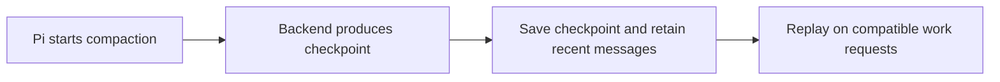

# 🗜️ pi-codex-compact — Use Codex Remote Compaction in Pi

[](https://www.npmjs.com/package/@narumitw/pi-codex-compact) [](https://pi.dev) [](./LICENSE)

Use Responses compaction in Pi to replace older conversation context with an opaque server-generated checkpoint.
The extension replays that checkpoint in later compatible requests. Pi still controls when compaction runs.

## ✨ Features

- Supports built-in Codex, OpenAI, and Azure OpenAI Responses APIs, plus explicitly configured custom APIs.
- Offers Remote Compaction V2, unary `responses/compact`, and experimental streaming Context Management.
- Handles manual, threshold, and overflow compaction through Pi's normal lifecycle.
- Preserves compatible checkpoints across repeated compaction, protocol changes, reloads, resumes, and forks.
- Uses Pi-native fallback before the first checkpoint; afterward, tries checkpoint-aware recovery with lossy native fallback on recovery failure.
- Pauses an operation rejected by OAuth without disabling compatible checkpoint replay.

**Context Management is experimental and requires explicit opt-in.** It consumes the active route's quota or API usage; support depends on the backend, model, and account. Default routing is unchanged.

## 📦 Install

Install persistently from npm:

```bash
pi install npm:@narumitw/pi-codex-compact
```

Try the published package without installing:

```bash
pi -e npm:@narumitw/pi-codex-compact
```

Try a local checkout from the repository root:

```bash
npm --workspace @narumitw/pi-codex-compact run build
pi -e ./packages/pi-codex-compact
```

The package declares `dist/index.ts`, so build a local checkout before loading its package directory.
Loading it enables automatic Responses compaction routing with the defaults below.
Do not load a global npm installation and the local workspace at the same time.

Pi extensions run with your user permissions. Review third-party extension source before installing it.

## 🚀 Quick start

1. Sign in through Pi's built-in OpenAI, OpenAI Codex, or Azure OpenAI provider.
2. Select a model using `openai-codex-responses`, `openai-responses`, or `azure-openai-responses`.
3. Work normally. Pi's automatic compaction and built-in `/compact` remain available.

After successful remote compaction, compatible requests replay the checkpoint automatically.
Signing in does not guarantee compaction permission; see [ChatGPT OAuth rejection](#chatgpt-oauth-rejection) if the backend refuses the operation.

## 💬 Commands

Run `/codex-compact` without arguments to inspect the effective route, change settings, or select **Compact now** in TUI mode.
Closing the menu with Escape or Ctrl+C does not compact the session; settings changes already saved remain applied.
RPC reports the manual settings path without compacting. Print and JSON modes reject the command.
Pi's built-in `/compact` uses the same compaction routing.

## ⚙️ Settings

Use `/codex-compact` → **Settings**, or edit the global JSON file at `<getAgentDir()>/pi-codex-compact.json` (normally `~/.pi/agent/pi-codex-compact.json`).
There are no project or extension-specific environment-variable overrides. Missing fields use defaults.

For example, select Remote V2 explicitly on a compatible backend:

```json
{
  "protocol": "remote-v2"
}
```

The default `auto` protocol uses Remote V2 for Codex Responses and unary `responses/compact` for OpenAI and Azure OpenAI Responses. Other APIs remain Pi-native unless explicitly configured.
Menu changes apply immediately. Manual file edits take effect on `/reload` or the next session start. Invalid settings files remain unchanged and make the menu read-only until repaired and reloaded.

See the [settings reference](./docs/settings.md) for all fields, defaults, accepted values, custom API configuration, and save/reload behavior. This extension does not read `~/.codex/config.toml`.

## ✅ Requirements and compatibility

You need compatible Pi peer APIs, working provider credentials, and a backend that supports both the selected compaction protocol and opaque checkpoint replay.
The model must use a built-in Responses API or a custom API explicitly mapped through `apiProfiles`.
The provider adapter must honor Pi's public `onPayload` and injected `fetch` options; Context Management and summary recovery also need ordered `onProviderStreamEvent` callbacks.

| Model API | `auto` route | Other selectable route |
| --- | --- | --- |
| `openai-codex-responses` | Responses Remote V2 | Responses Compact API, experimental Context Management |
| `openai-responses` | Responses Compact API | Responses Remote V2, experimental Context Management |
| `azure-openai-responses` | Responses Compact API | Responses Remote V2, experimental Context Management |

For a custom API, map its exact non-built-in label to `"codex-responses-v1"` in `apiProfiles`. This profile uses Remote V2 in `auto` mode and requires Codex-compatible request fields and replay; it declares compatibility rather than probing the backend. With unary compaction selected, it retains Codex-supported tools and reasoning.
Built-in adapter tests cover request plumbing, not backend support or hosted entitlement. A custom provider or proxy remains responsible for its routing, authentication, and payload transforms. See the [implementation reference](./docs/implementation.md#protocol-and-replay) for the protocol contract.

Opaque checkpoint replay requires its issuing provider and an authorized API/profile; the recorded model ID does not gate replay within that boundary. Custom checkpoints also require the matching `apiProfiles` entry.
With summary recovery enabled, a compatible provider change can request a lossy plaintext transfer through the issuer instead of sending encrypted state to the target; see [Provider changes](./docs/implementation.md#provider-changes). An incompatible API/profile exposes the fallback marker and recent messages, not the checkpoint's older history.
The extension does not make capability probes or automatically retry a failed billable request through another protocol.

### Experimental Context Management

For a backend supporting [server-side compaction](https://developers.openai.com/api/docs/guides/compaction), select **Context Management (experimental)** in `/codex-compact` → **Settings** → **Protocol**, or save this setting and reload Pi:

```json
{
  "protocol": "context-management"
}
```

This route was verified with Pi's **OpenAI → Sign in with ChatGPT**, `gpt-5.5`, and streaming `api.openai.com/v1/responses`: a checkpoint recovered an assistant-only synthetic fact without the original plaintext. This does not establish support for other accounts, models, Azure, Codex, or proxies.

Compaction makes a separate inference request that asks for a concise work handoff, not a fixed `OK` reply. Tools are disabled only for that maintenance request. Safe generated output is saved with the checkpoint, not displayed as new assistant work. Missing or unsafe output follows the fallback/recovery policy; very short history may not meet the server's 1,024-token threshold. Both maintenance and recovery can consume quota.

After successful automatic compaction during a user run, work continues without another user message. Existing Pi retries and queued work are reused; otherwise, the extension can start one extra work request per user run, even if that request compacts again. Normal tools remain available, so the extra request can consume quota and execute actions. It asks the model not to repeat completed work, but cannot guarantee model compliance or task completion.

Manual compaction, native fallback, plaintext recovery, other protocols, and restored checkpoints do not start this extra request. Failure, cancellation, terminal errors, session changes, or incompatible model/settings suppress pending continuation. Other extensions using Pi's continuation API can override it.

To stop new Context Management attempts, select `auto` or another protocol while leaving the extension enabled for replay. Existing checkpoints are not rewritten and can contain older maintenance instructions or `OK` output. Older package versions do not understand Context Management checkpoints; retain a supporting version for these sessions.

### ChatGPT OAuth rejection

Pi's **OpenAI → Sign in with ChatGPT** route at `api.openai.com` is distinct from the legacy **OpenAI Codex** route at `chatgpt.com/backend-api/codex`. Permission on one does not establish permission on the other. General compaction API documentation also does not establish OAuth permission.

A backend can reject an operation with:

```text
code=hardened_oauth_rule_missing
type=rejected_by_hardened_oauth_boundary
message=This ChatPass credential is not authorized for the requested operation.
```

The extension reports the rejection and pauses that operation for the session route. Without a checkpoint, it falls back to Pi-native compaction; with one, it uses [checkpoint recovery](#checkpoint-recovery). It does not switch credentials, providers, or protocols automatically. The menu's selected route is not an entitlement check, and forcing Remote V2 is not a verified workaround.

Changing the protocol or backend can permit a new attempt; switching back to the rejected route remains paused. `/reload` or a new session clears the pause. Re-login or upgrading Pi is not a guaranteed remedy. See OpenAI's [inference](https://developers.openai.com/siwc/token-sharing-open-source/models-and-inference) and [errors and recovery](https://developers.openai.com/siwc/token-sharing-open-source/errors-and-recovery) guidance, plus the [route-pause details](./docs/implementation.md#oauth-rejection-state).

**Turning Remote compaction off also disables opaque checkpoint replay.** Do this only for sessions that do not need an existing checkpoint. Otherwise, leave the extension enabled and use recovery; disabling it exposes only the fallback marker and recent messages.

### Checkpoint recovery

Pi's native summary generator cannot read encrypted checkpoint history. Direct native fallback after a checkpoint can therefore lose older context.

After remote failure with a checkpoint, **Checkpoint recovery → Summarize** (the default) makes a normal inference request through the same compatible provider/model and Pi-managed credentials. It replays the checkpoint, disables tools, and replaces it with a bounded plaintext summary while retaining the recent tail and file metadata. This consumes quota and is lossy; successful validation cannot prove that every fact was preserved. Ordinary work requests do not receive recovery instructions.

If the recovery request fails, times out, or returns invalid or oversized output, **Summarize falls back to Pi-native compaction**. Native compaction can summarize only the fallback marker and visible history; **older context stored only in the opaque checkpoint may be lost**. With `notifyOnFallback` enabled, the extension warns before handing control back to Pi. Recovery and native summarization can each consume quota; native failure follows Pi's normal failure handling.

**Checkpoint recovery → Cancel** avoids the recovery request and native fallback and preserves history. Invalid or incompatible checkpoints, unverifiable projection, or a changed recovery backend still cancel. Cancellation, session changes, shutdown, model selection, and completed tree navigation stop owned compaction work rather than triggering fallback. Neither recovery mode changes fallback before the first checkpoint. A context-limit turn can remain blocked until compaction succeeds.

If checkpoint projection cannot be verified, another recovery attempt cannot repair it. Keep a backup, use `/tree` to branch before the opaque checkpoint, decline optional branch summarization, and compact the saved transcript on that branch. For nested checkpoints, branch before the earliest required one or restore the original transcript from backup. The abandoned branch is unchanged; missing opaque-only history cannot be decoded locally.

Keep the extension enabled while the active session needs its checkpoint; recovery does not override `enabled: false`. Hosted checkpoint-to-text recovery remains unverified. Adapter tests establish safe request/publication behavior, not hosted recall.

## 🧭 How it works

Pi chooses when to compact and which recent messages to keep. The extension requests a checkpoint for older context, saves it in the session, and replays it alongside the retained messages on compatible requests.



If a request fails, the extension uses native fallback before the first checkpoint or checkpoint-aware recovery afterward, with lossy native fallback if the recovery request fails. See the [implementation reference](./docs/implementation.md) for protocol fields, checkpoint validation, continuation, and legacy format handling.

## 🔒 Security and privacy

Remote compaction sends conversation context and the system prompt to the configured Responses backend. Remote V2 and Context Management also send active tool schemas; Codex-profile unary requests retain provider-supported tools.
The session stores the provider ID, encrypted checkpoint, and bounded retained user items or Context Management output. It does not store credentials or authorization/request headers in checkpoint details.

| Boundary | Limit |
| --- | ---: |
| Observed SSE stream or unary JSON response | 8 MiB |
| Serialized checkpoint or retained output item | 2 MiB |
| Persisted replacement history | 8 MiB |
| Retained user text or Context Management output suffix | 64K approximate tokens by default; configurable from 8K to 128K |
| Settings file | 64 KiB |
| Transport retries | At most 2 |
| Request timeout | At most 10 minutes |

An individually oversized media item is dropped. The oldest fitting retained text item may be partially truncated to preserve newer context.
Context Management does not retain the original plaintext alongside its checkpoint and fails rather than truncating oversized post-checkpoint output. Hard byte ceilings are not configurable.

## 🚧 Limitations

- Backend compaction contracts and OAuth restrictions can change independently; keep backups of important sessions.
- Opaque checkpoint replay requires this extension, its issuing provider, an authorized API/profile, and a backend that accepts the checkpoint. Removing the extension exposes only the fallback marker and recent messages.
- The package does not reproduce Codex core's context-window lineage, previous-model fallback, exact pre-turn ordering, or exact mid-turn model-session ownership.
- Pi's public tool metadata omits `constrainedSampling`; Remote V2 preserves active tool order, names, descriptions, and schemas but cannot reproduce that optional field.
- Successful recovery replaces active opaque history with a lossy summary; native fallback after recovery failure cannot read opaque-only history. Raw session entries remain available, but rolling back the extension does not restore the active context. Use `/tree` before the required checkpoint or restore a transcript backup.
- Settings saves are ordered within one Pi process, not locked across processes; a detected concurrent edit is rejected.

## 📊 Benchmark

The repository benchmark compares full context, Pi-native summaries, and Remote V2 using seeded histories. Its v3 protocol uses repeated artifacts, isolated probes, paired seed statistics, and committed manifests. It does not treat equal nominal token settings as equal information capacity or claim that exploratory evidence is held out.

Preview the exploratory diagnostic without a provider request:

```bash
npm run benchmark:codex-compact
```

Live runs require `--live`, cost/privacy review, OpenAI Codex OAuth, and Remote V2 entitlement. See the [benchmark guide](https://github.com/narumiruna/pi-extensions/tree/main/packages/pi-codex-compact/benchmark) for methodology, archived v2/v3 evidence, and consumed seeds that cannot be reused for confirmation.

## 🧪 Development

From the repository root:

```bash
npm --workspace @narumitw/pi-codex-compact run check
npm test
npm run package:pack -- codex-compact
```

See the bundled [implementation reference](./docs/implementation.md) for current behavior and [Codex mechanism research](./docs/codex-compaction-mechanism.md) for pinned upstream history and design lessons.

## 🗂️ Package layout

```text
packages/pi-codex-compact/
├── src/                       # Implementation; index.ts is the thin source entrypoint
├── dist/                      # Generated Jiti runtime, built from src/index.ts
├── docs/                      # Published settings and implementation references
├── scripts/build-runtime.mjs  # Runtime builder
├── benchmark/                 # Repository-only benchmark and methodology
└── test/                      # Behavior and lifecycle coverage
```

The generated runtime does not import back into `src`.

## 🔎 Keywords

Pi extension, OpenAI Codex, ChatGPT OAuth, Azure OpenAI, Responses API, remote compaction, context management, opaque checkpoint.

## 📄 License

[MIT](LICENSE)
