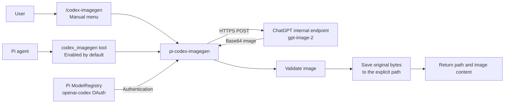
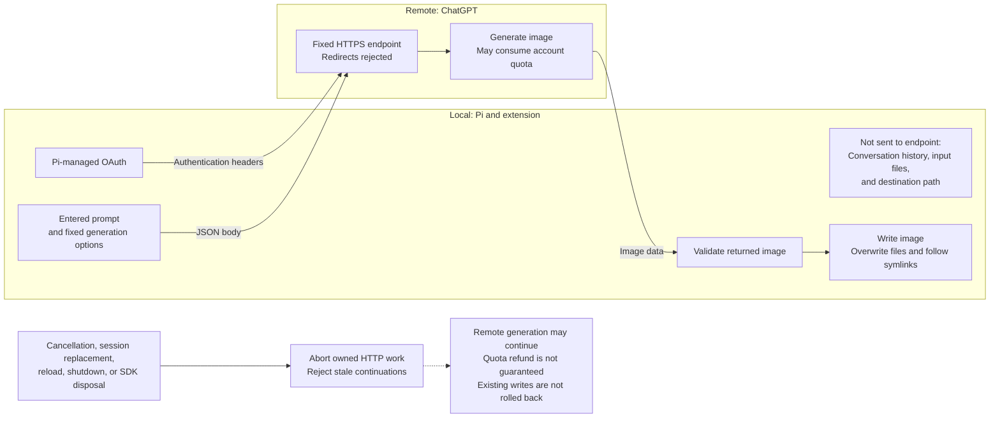

# Architecture

`pi-codex-imagegen` generates images directly from Pi without starting Codex CLI, another agent, or Codex plugins. These diagrams describe the current implementation.

> **Endpoint:** The request contract is confirmed against [OpenAI Codex source](./protocol.md#source-mapping). The extension uses an internal ChatGPT endpoint, not the public OpenAI Images API. Real account access and transparent output have not been verified. See the [verification guide](./verification.md) for the remaining live checks and publication restrictions.

## Component boundaries

The manual menu and the optional model tool share one generation pipeline. Pi supplies OAuth authentication; the extension sends the request, validates the returned image, and saves its original bytes.

The main Pi model can use another provider. Image generation requires compatible Pi `openai-codex` OAuth; a login held only by Codex CLI is not used.

## Data and cancellation boundaries

Only the entered prompt and fixed generation options are sent as the request body. Pi supplies the token and account header. Conversation history, input files, and the destination path are not sent to the image endpoint.

Paths follow Pi's `write` behavior and are not confined to the repository. Symlinks can direct writes outside the project. Cancellation is best effort for filesystem writes, and an image saved before late cancellation remains on disk. Pi-owned OAuth refresh can also finish after the extension stops waiting.

## Implementation references

The diagrams map to these package modules:

- [`codex-imagegen.ts`](../src/codex-imagegen.ts): entry routes, shared generation pipeline, result publication, and session ownership.
- [`image-client.ts`](../src/image-client.ts): authentication checks, fixed endpoint, request limits, and HTTP cancellation.
- [`artifacts.ts`](../src/artifacts.ts): image validation, destination preflight, and binary file writes.
- [`menu.ts`](../src/menu.ts): manual generation and menu navigation.

See the [protocol contract](./protocol.md) for detailed authentication, failure, and storage behavior, and the [README](../README.md) for installation and use.

See [Workflows](./workflows.md) for manual generation, model-driven generation, and request ordering.
