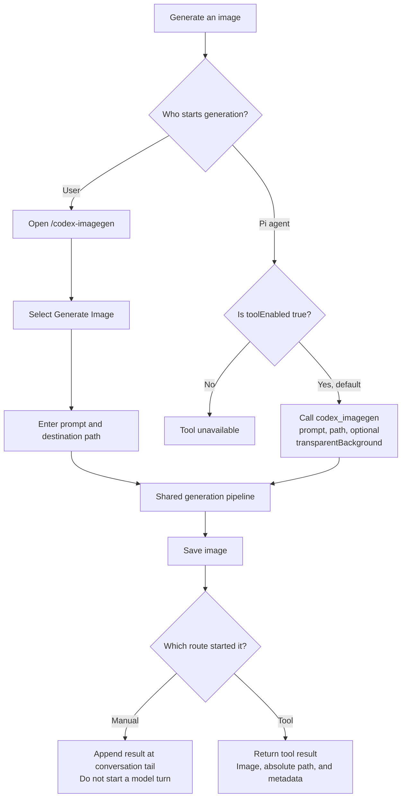

# Workflows

The manual menu and the optional model tool use the same image generation pipeline. These diagrams describe the current implementation. See [Architecture](./architecture.md) for component and data boundaries, including the internal endpoint limits.

## Manual and model-driven generation

Manual generation does not require tool enablement. Model-driven generation is enabled by default and can be disabled through Settings. Both routes require a prompt and an exact destination path.



The command requires TUI mode and accepts no arguments. The enabled tool also works in headless modes. Manual preview resizing does not change the original image file.

## Request sequence

The extension checks the destination before making the HTTP request. After each asynchronous step, it checks whether the session and request still own the operation before continuing.

```mermaid
sequenceDiagram
    participant Caller as Menu or tool
    participant Extension as Extension
    participant Files as Filesystem
    participant Pi as Pi ModelRegistry
    participant API as ChatGPT endpoint

    Caller->>Extension: Prompt, path, background option
    Extension->>Extension: Check session, input, and busy state
    Extension->>Files: Preflight path; create parent directories if needed
    Extension->>Pi: getProviderAuth("openai-codex")
    Pi-->>Extension: Resolved OAuth authentication
    Extension->>Extension: Recheck session and authentication compatibility
    Extension->>API: POST /backend-api/codex/images/generations
    alt Successful response with a valid image
        API-->>Extension: JSON containing one Base64 image
        Extension->>Extension: Validate format, byte size, and dimensions
        Extension->>Files: Write original image bytes
        Extension-->>Caller: Image, absolute path, and metadata
    else Request failure or invalid image
        Extension-->>Caller: Report error; no automatic retry
    end
```

The model is fixed to `gpt-image-2`, with size and quality set to `auto`. The extension does not generate filenames, adjust extensions, or convert image formats. Authentication waits are limited to 30 seconds within a five-minute total authentication/HTTP budget.

Preflight can create parent directories even if generation later fails. A filesystem write failure can leave a truncated or partially replaced file; image writes are not atomic and are not rolled back.

## Implementation references

[`codex-imagegen.ts`](../src/codex-imagegen.ts) owns the shared generation pipeline and result publication. [`menu.ts`](../src/menu.ts) owns manual generation, and [`image-client.ts`](../src/image-client.ts) owns HTTP requests and authentication checks.

See the [protocol contract](./protocol.md) for detailed failure and cancellation behavior, and the [verification guide](./verification.md) for remaining live checks.
