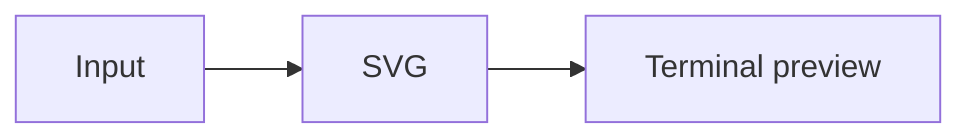

# 🖼️ pi-illustrate

[](https://www.npmjs.com/package/@narumitw/pi-illustrate)
[](https://pi.dev)
[](./LICENSE)

Preview static SVG and Mermaid diagrams in Pi through the Kitty graphics protocol. Mermaid rendering uses the local [Pele](https://pele.run) library, not a remote service.

## ✨ Features

- Render diagrams inline without opening a browser or writing image files to the project.
- Follow the available terminal width while preserving the image aspect ratio.
- Match Mermaid colors to Pi's light or dark appearance without changing the diagram layout.
- Send an image to the model only when the tool call explicitly requests it.

## 📦 Install

Extensions run with Pi's permissions. Review the source before loading it. A terminal that Pi recognizes as Kitty-capable is required; tmux, screen, and iTerm2 image transport are not supported. System fonts must cover the text in the diagram.

This package has not been published. From the repository root:

```bash
npm install
npm run build
pi -e ./packages/pi-illustrate
```

To keep this local checkout installed:

```bash
pi install ./packages/pi-illustrate
```

The extension loads from source. The repository build prepares the Kit menu library; no generated extension bundle is needed.

After a separately approved npm publication, install or try it with:

```bash
pi install npm:@narumitw/pi-illustrate
pi -e npm:@narumitw/pi-illustrate
```

## 🚀 Quick start

In a Kitty-capable Pi TUI, ask the model to call `illustrate_mermaid` with this source:



The diagram appears inline. Open `/illustrate` to inspect terminal status or change defaults. Normal agent requests still use your selected provider; diagram rendering itself does not call a provider.

## 💬 Commands

`/illustrate` opens diagram settings, terminal status, and help. It takes no arguments and opens menus only in TUI mode. RPC receives an unsupported-mode notification with the settings path. Print and JSON report command rejection on stderr without starting model work. Unknown or trailing arguments produce a command error.

Settings save immediately. Escape returns to the menu without undoing saved changes; Ctrl+C closes the flow. A custom numeric width uses Pi's native single-line input.

## 🛠️ Tools

| Tool | Required input | Purpose |
| --- | --- | --- |
| `illustrate_svg` | `svg` | Preview self-contained static SVG text without changing its colors. |
| `illustrate_mermaid` | `source` | Lay out Mermaid once with Pele and preview it with appearance-aware colors. |

Both tools accept `cols` and `sendToModel`:

- `cols: "auto"` follows the available tool content width. A positive safe integer sets a maximum width in terminal columns; narrow terminals shrink it. Omission uses the user default, initially `"auto"`.
- `sendToModel: false` is the default for every call. With `true`, an immutable PNG snapshot is included in model context and can use image tokens. The selected model must support image input. There is no global switch for this option.

```json
{
  "source": "flowchart LR\n  A[輸入] --> B[預覽]",
  "cols": "auto",
  "sendToModel": false
}
```

The tools require TUI mode and Kitty image capability, even with `sendToModel: true`. Print, JSON, RPC, and unsupported terminal paths fail before rendering. Pi's show-images preference is respected; disabling inline images does not cancel an explicitly requested model snapshot.

The saved tool content remains text-only. A deterministic context projection adds only the explicitly requested snapshot to the model-visible tool result. The terminal still displays one preview, not a second copy of that snapshot. Resize and palette changes never change the earlier model snapshot or the earlier request prefix.

### Sizing and rendering

Pi's available component width and cached character-cell pixels determine the target image size. The cell dimensions can be estimated; they do not identify the physical monitor resolution. Geometry is rounded to terminal cells.

Shrinking reuses the current PNG. Enlargement also reuses it while its resolution is sufficient. When more resolution is needed, the preview scales immediately and a new PNG is generated after resize has stopped for 150 ms. A Mermaid appearance change requests a new PNG without rerunning the layout. Missing previews and old Mermaid palettes are labeled during updates.

A full render queue delays updates and is retried automatically. Other rendering errors remain visible and are not retried for the same size and appearance.

At the 64-preview cache limit, completed tool calls still return their record and any requested model image; an uncached local preview shows the limit instead.

Fixed limits cap resolution and work; reaching the pixel limit can leave a large display upscaled. This is not a claim of pixel-perfect rendering on every terminal or display density.

## ⚙️ Settings

Open `/illustrate` and choose Settings. User settings are stored in `<getAgentDir()>/pi-illustrate.json`, normally `~/.pi/agent/pi-illustrate.json`. Reads do not create this file. There are no project settings or extension-specific environment variables.

| Setting | Values | Default | Applies to |
| --- | --- | --- | --- |
| `defaultCols` | `"auto"` or a positive safe integer | `"auto"` | Later calls that omit `cols`. An explicit call value always wins. |
| `mermaidAppearance` | `"auto"`, `"dark"`, `"light"` | `"auto"` | Current and future Mermaid previews; `"auto"` follows Pi's `theme.appearance`. |

With Pi's `system` theme, automatic appearance follows the terminal information Pi receives. With a fixed Pi theme, it follows that theme instead. These settings do not recolor user-supplied SVG or change historical model snapshots.

UI edits save and apply immediately. Manual file edits load at session start, `/reload`, session replacement, or tree navigation. Unknown fields are preserved. Invalid documents produce a warning and block saves until repaired. Failed saves restore the previous effective value. Writes use atomic rename and are ordered within one process; separate Pi processes are not coordinated.

## 🔒 Security and privacy

Rendering is local. Source cannot load remote images, local files, external fonts, CSS imports, scripts, or HTML. Only a bounded static SVG subset is accepted. Rendering runs in a bounded child process; cancellation or timeout terminates that process, including synchronous native rendering.

Raw diagram calls, bounded SVG reconstruction data, and opted-in PNG snapshots remain in Pi's session storage. Preview caches are session-owned. Do not include secrets you do not want stored in a session or sent to the selected model. `sendToModel: false` excludes image bytes from model context; the model can still see its original tool arguments and the textual tool result.

No diagram files are written into the project. Explicitly saving settings writes only the user settings file. No browser, network renderer, API key, or new authentication flow is used.

## 🚧 Limitations

Pele has its own Mermaid-compatible syntax support, layout, and visual style; it is not a pixel-identical Mermaid.js replacement. External diagram plugins, interactive links, images, math resolvers, and custom icon resolvers are not enabled. Raw SVG filters, embedded images, animation, `foreignObject`, external resources, and unsupported CSS constructs are rejected rather than rendered inaccurately. CSS variable cycles, oversized selector specificity, and diagrams that combine `<use>` with CSS variables are also rejected; flatten those references or use fixed presentation values.

Pi can fail to detect images through terminal multiplexers or SSH. This package does not force global terminal capability overrides. Cached cell pixels can be estimates or become stale after font zoom. Missing system fonts can change label metrics or show missing glyphs, especially for CJK and emoji.

Work is bounded to 50,000 input characters, 4 MiB normalized SVG, 1,000 edges/references, 20,000 SVG elements, depth 128, 1,000 CSS rules, 8,000,000 raster pixels, 8,192 pixels per raster axis, and 4 MiB PNG. One worker runs at a time with at most four accepted operations and a 128 MiB JavaScript heap. Worker startup and each ready-worker operation have separate five-second deadlines. Pixel limits bound output bitmaps; the JavaScript heap limit is not an OS-level limit on native memory. The child process provides cancellation, not a general-purpose security sandbox.

A session caches at most 64 previews and 32 MiB of compressed preview data. An evicted preview reports the cache limit; a size or appearance change can request it again. Display height is limited to 4,096 terminal rows. The host's own transcript and session storage are outside this cache budget.

Automated tests cover rendering and protocol data, not physical terminal acceptance. See [verification and external handoff](./docs/verification.md) for remaining visual, platform, and release checks. No publication or release action is authorized by local verification.

## 🗂️ Package layout

- `src/index.ts` forwards the extension factory; `src/` owns tools, settings, the menu, responsive previews, and native ESM render workers.
- `docs/` contains verification instructions and external handoff limits.
- `test/` contains repository-only settings, rendering, lifecycle, model-context, and runtime-loading tests.

## 🔎 Keywords

Pi, SVG, Mermaid, Pele, Kitty graphics, terminal images, diagram preview, dark mode.

## 📄 License

[MIT](./LICENSE).
