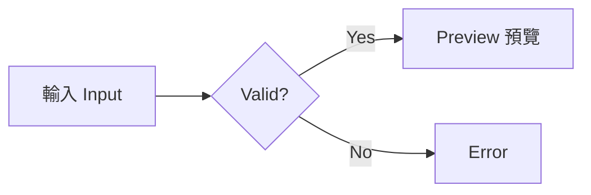

# Verification and external handoff

Automated verification does not establish physical terminal acceptance or authorize publication. This file retains the external checks after the implementation plan is removed.

## Automated checks

Run from the repository root:

```bash
npm run check
npm test
npm --workspace @narumitw/pi-illustrate run build --if-present
npm run package:pack -- illustrate
```

Run gates sequentially because root builds and Kit builds share generated output. `package:pack` is a dry run; an actual temporary tarball must also be inspected before a release.

The package tests cover atomic settings saves and failures, the real native ESM worker, scoped CSS-variable resolution, unsafe SVG rejection, cancellation, geometry and resource limits, responsive previews, theme changes, immutable model context, custom settings navigation, and no-provider SDK/CLI loading. Worker deadlines start after readiness; startup has a separate deadline.

`test/native-runtime.test.ts` loads the real package through Pi's public SDK, uses local deterministic provider behavior, and checks CLI JSON/RPC framing and mode rejection without a provider request. No automated test starts an interactive terminal.

`test/preview-session.test.ts` drives Pi's real regular and fullscreen renderers with a mock terminal. It checks that unrelated text updates do not resend image data, and that fullscreen movement, scrolling, and forced redraws reuse uploaded PNGs in the default and WezTerm output paths. Geometry and bitmap changes rebuild the encoded output. The session cache limit includes both PNG data and encoded image lines; these tests do not establish physical flicker acceptance.

## Completed implementation checks

- `npm run check` passed for the repository builds, Biome, boundaries, and workspace typechecks.
- `npm test` passed: 943 files, 21,244 tests passed, 34 existing tests skipped, and zero failures. The package has 307 passing tests, without per-test timeout increases.
- Real Jiti and CLI smokes exercised local rendering, command rejection, JSON/RPC framing, startup, and shutdown without provider requests.
- A real npm tarball was inspected, installed into an isolated consumer with runtime dependencies, and loaded through Pi. Its native ESM worker rendered a 320 by 78 pixel CJK Mermaid diagram with zero external requests.
- The semantic review covered the extension, settings, and README guides; model-prefix preservation after native system/tool patches; worker cancellation and stale ownership; queue-capacity retries and cache limits; rounded raster area; raw terminal-control assertions; atomic settings failures; SVG/CSS resource restrictions; and published import paths.
- The only shared test-configuration change copies package-owned `.mjs` runtime assets into the test output. There are no new Kit APIs, project settings, credentials, tool-activation switches, generated extension bundles, or extension-to-extension dependencies.
- `npm audit` reports one pre-existing low-severity `fast-xml-parser` advisory in the host dependency graph. Its lockfile entry is unchanged; this package does not use that parser. No forced audit fix was applied.

## Physical terminal check

Responsible role: a user or maintainer with a physical Kitty-capable terminal and a local Pi installation. Prepare the local package with `npm install` and `npm run build`, then run:

```bash
pi -e ./packages/pi-illustrate
```

Use `/illustrate` to check protocol detection, effective appearance, cached cell dimensions, Settings, Status, and Help. Check native navigation and a non-default keybinding set. Change a setting, close the menu, reopen it, and verify immediate persistence. Test Escape, Ctrl+C, and a pasted numeric width.

Use these inputs through the corresponding tools. Invoking a real agent to call the tools uses that agent's provider; choose whether to incur that separate usage.

```xml
<svg xmlns="http://www.w3.org/2000/svg" width="300" height="120" viewBox="0 0 300 120">
  <rect x="1" y="1" width="298" height="118" fill="#eef4ff" stroke="#3366aa"/>
  <text x="150" y="70" font-size="24" text-anchor="middle" fill="#17365e">SVG preview</text>
</svg>
```



Expected observations:

1. Each tool displays one image with its aspect ratio preserved. `sendToModel: false` has no image in model input; `true` has one immutable snapshot when the model supports images.
2. `cols: "auto"` adapts to a narrow and wide window. `cols: 40` does not exceed forty available columns. A tall diagram can scroll without cropping its content.
3. Shrinking stays responsive. Enlargement beyond the cached resolution settles to a sharp image after resize stops. Rapid changes do not restore an older size or palette.
4. Mermaid follows Pi appearance or the explicit override. Raw SVG keeps its colors. Existing model snapshots do not change.
5. Inspect English and CJK label metrics, contrast, and missing glyphs with installed fonts.
6. In regular and fullscreen modes, scroll images out of view and back, resize, change theme, zoom the terminal font, navigate a session branch, `/reload`, and quit. Watch for flicker during scrolling and unrelated text updates. No owned workers or stale previews should remain after teardown.

Unverified until observed: physical rendering, terminal mouse routing, subjective clarity and contrast, scrolling/placement cleanup, platform-specific fonts, font-zoom refresh, and actual HiDPI behavior. Do not claim validation for an untested terminal or platform. These observations are external acceptance checks, not unfinished automated code tasks.

## Release restriction

Responsible role: the package owner. After reviewing the verified code and remaining terminal/platform limits, separately authorize any npm publication, visibility change, version tag, or release workflow. Registry availability and credentials must be checked at that time. Local tests do not prove publication rights, and the implementation authorization does not include a release.
