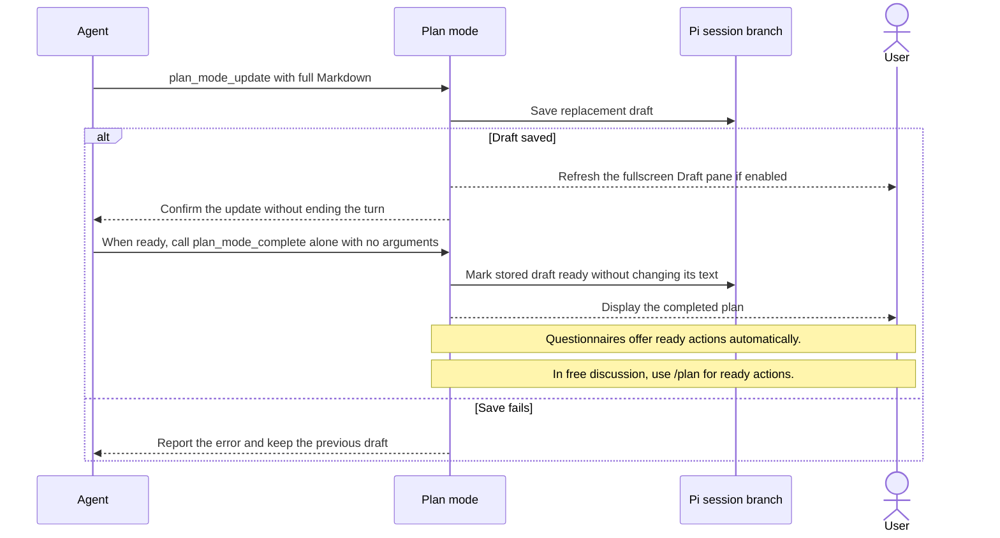

# Plan command workflows

[Back to README](../README.md#-commands)

## Start and choose tools

`/plan start` activates Plan mode without sending a model message.
`/plan <prompt>` starts with an initial planning message, or sends an ordinary follow-up when already active.
Only the exact argument `start` selects direct activation; `/plan start a migration` is a planning prompt.
There is no startup flag; run `/plan start` after Pi launches.

Before starting, `/plan tools` or **Choose tools, then start…** stages a session-specific tool policy.
**Done — start with this policy** stores the selection and starts Plan mode.
Back, Escape, Ctrl+C, disposal, session replacement, or shutdown discards the unconfirmed draft without changing Plan state, active tools, thinking, or stored selection.
Persistent defaults belong in [Settings](./settings.md).

The TUI selector supports fuzzy search and paging; RPC shows the unfiltered list.
The selector distinguishes callable tools, inactive direct tools, hidden tools, blocked policies, and pending registration.
**Inactive in Pi** means Pi must enable the tool separately; **blocked by Plan policy** cannot be enabled by selecting the row.
For inactive built-in `grep`, `find`, and `ls`, follow the [Pi settings setup](./settings.md#enable-inactive-built-in-search-tools-in-pi) before reopening the selector.
Native MCP tools are explicit opt-ins; registered `codemode` and `deferred` exposure is selectable without direct activation.
Select the needed orchestrator separately, and select every nested callee; neither choice grants the other permission.
Selected names awaiting metadata stay selected for first-request resolution.
Reopen the selector to refresh newly registered tools.
Active and ready workflows lock the Plan tool policy; exit and start a new workflow to change the allowlist.
See [Planning and implementation](../README.md#-planning-and-implementation) for the first-request policy boundary and the same-session and fresh-session handoff options.

## Questionnaires and free discussion

Every new Plan workflow starts with questionnaires enabled.
In TUI, F2 switches the active workflow between questionnaires and free discussion only while the main editor is idle or that workflow's questionnaire is open.
It does not leave Plan mode or change its tool policy: file edits and unsafe shell forms remain blocked.
If any effective native Pi keybinding uses F2, Plan mode does not register or display F2 and does not choose a replacement key.
Use **Switch to free discussion** or **Enable questionnaires** in the active `/plan` menu instead, including when a completed plan is ready.
The widget shows F2 only when available, otherwise the `/plan` entry point.
The existing `toggleShortcut` setting still controls entry to and exit from Plan mode, not this interaction switch.

Switching from an open questionnaire closes it, discards every unfinished answer, custom answer, and note, and stops its run's automatic continuation.
The main prompt draft stays unchanged; no questionnaire content is copied into it and no message is sent.
Free discussion permits plain-text follow-up questions and ordinary text responses without opening questionnaires.
The agent cannot enable questionnaires itself.
Enabling them again changes only the interaction mode: it does not call the model, reopen old questions, or open a previously suppressed ready menu.
After the next user message, the agent decides whether new questions are needed from the latest discussion.

A completed plan in discussion is displayed and stored with `plan ready`, while the widget continues to show free discussion.
No automatic action menu takes focus; open `/plan` manually to implement, save, export, revise, or exit.
The interaction mode restores with its active workflow after reload, resume, branch navigation, and compaction; old sessions without this state use questionnaires.
Leaving, saving, or handing off the plan does not carry discussion mode into the next workflow.

RPC uses the same active `/plan` menu while idle; it does not receive the TUI F2 shortcut.
RPC questionnaire cancellation keeps its existing behavior and does not switch interaction mode.
Other running work and unrelated dialogs do not accept the toggle.
Print and JSON modes do not add interactive UI or an interaction-switch route.

## Drafting and completion

A draft is the agent's latest working plan. Read it under **Draft** in the fullscreen Plan pane, or use `/plan show` in TUI or RPC to display **Draft Plan**. Drafts do not open a ready-plan menu and cannot be saved for later, exported, or implemented.

1. `plan_mode_update({ plan })` replaces the whole draft with Markdown, not a patch.
   It rejects blank input, plans over 50,000 JavaScript characters, or plans whose eventual completion result exceeds Pi's 50 KB or 2,000-line output limit. It does not truncate the plan.
   After storing the plan on the current Pi session branch, the tool refreshes the pane and returns a short confirmation without ending the turn.
   A rejected update or failed save keeps the previous draft. Updating does not write `PLAN.md` or any other project file.
2. If a material decision remains, the agent can update first, then ask with `plan_mode_question` when questionnaires are enabled.
   Free discussion allows plain-text questions and can end with just an update.
   If the text has not changed, there is no need for another update.
3. When the draft is decision-ready, the agent calls `plan_mode_complete({})` as the sole tool call in a separate assistant message.
   It takes no arguments. Plan mode rejects batched or nested completion calls before tool execution. If the branch has no draft, completion fails without changing state.
   Otherwise the tool marks the exact stored text `plan ready`, returns it as Markdown, and requests turn termination with Pi's `terminate: true`.
   Plan mode remains active and does not start implementation.

The completion call uses the last successfully stored draft. The ready actions are available after completion, not after an update:

A user follow-up after completion dismisses the ready menu and returns the completed plan to draft state. The agent can replace it if revisions are needed or complete it unchanged after answering a clarification. Save, export, and implementation become available again only after completion.

The draft follows the active session branch across `/reload`, resume, and `/tree`.
If compaction removes its model-visible copy while Plan mode is active, the extension restores one copy at the conversation tail without rewriting history.
Exit or a new workflow does not carry the earlier draft forward.

### Finalization and retry

`/plan finalize` and its exact finalization prompt explicitly ask the agent to complete the draft or ask one remaining material question.
The same tools apply: update when no draft exists or its text changes, then complete separately. An update alone does not fulfill the finalization request.

With questionnaires enabled, if the request ends normally without a valid structured question or completion, Plan mode waits for the run to settle and retries once with stronger tool guidance.
A valid question, accepted completion, cancellation, exit, workflow supersession, reload, session replacement, or shutdown cancels the retry.
If the retry also fails, Plan mode remains active and warns in interactive modes. Run `/plan finalize` again to request another attempt.
Ordinary turns do not start this retry. Free discussion can finish the plan or ask in plain text without a structured-tool retry.

### Upgrading an existing session

The older `plan_mode_complete({ plan })` input is no longer accepted. Call `plan_mode_update({ plan })` first, then `plan_mode_complete({})` separately. New prose, including `<proposed_plan>` blocks, never completes a plan.

Saved plans, historical completion tool results, and legacy `<proposed_plan>` completion records remain readable. On restoring an older in-progress workflow, the extension appends the new versioned instructions once before the next model request. Existing messages are not rewritten.

## Busy transitions and recovery

Wait for Pi's run to settle before starting, exiting, saving, exporting a ready plan, implementing, or using another state-changing menu action or configured shortcut.
Busy transitions leave state unchanged and report a warning in TUI/RPC or an error in print/JSON mode.
The scoped F2 switch inside the current questionnaire is the only interaction-switch exception described above.
An ordinary follow-up or `/plan finalize` can still run while Plan mode is active because neither changes its mode contract.

`show` can display a draft; `save`, `export`, and `implement` require an applicable completed plan. `finalize` requires active Plan mode.
Cancellation and failed implementation preflight leave the stored plan intact.
For fresh-session recovery and non-interactive limitations, see [Planning and implementation](../README.md#-planning-and-implementation).

## Export Markdown

`/plan export [path]` writes a ready, saved, or active implementation plan, never a draft.
Without a path, it uses the configured **Export destination**, defaulting to `PLAN.md`; an explicit path always overrides the setting for that export.
Relative paths resolve from Pi's current working directory at export time, absolute paths stay absolute, a leading `@` is accepted, and missing parent directories are created.
Existing files, directories, and symbolic links are never overwritten: choose another path or remove the target first.
The output preserves accepted Markdown exactly apart from one trailing newline.

In TUI or RPC, **Export plan…** asks for a destination and shows the configured value and its resolved path.
Submit an empty value to use the configured destination.
A failed export retains the TUI draft for correction or reopens the RPC input; Escape returns without writing.

A successful ready-plan export ends Plan mode, restores thinking, and clears the ready state without starting a model turn or changing active tools.
Saved and active implementation exports preserve their existing state.
Failed or cancelled exports leave Plan state unchanged.
Export is an explicit user-requested file mutation, and the resulting file can be read with normal tools; model-initiated Plan-mode writes remain blocked.
