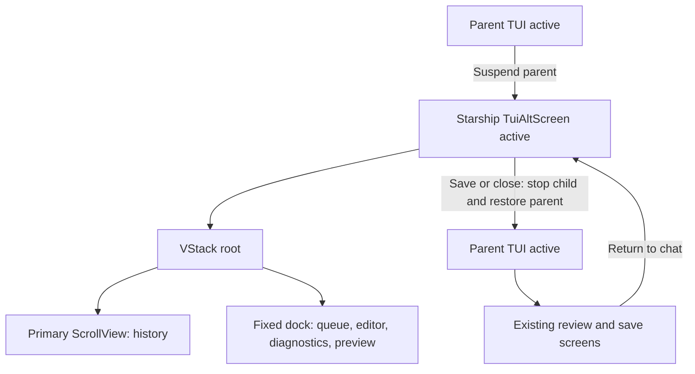

# Configuration chat runtime

Starship's configuration chat temporarily owns the terminal through its own `TuiAltScreen`.
The parent TUI is suspended, not run as a concurrent renderer. The chat uses a native `ScrollView` for history and a fixed dock for queued messages, the editor, diagnostics, and footer preview.
See the [README](../README.md#-configuration-chat) for user controls, draft safety, and provider-data warnings.

## Scope and compatibility

This change replaces the chat's parent-hosted fullscreen overlay and manual history paging.
It does not change the independent configuration agent, tool permissions, model-visible instructions, authentication, transcript retention, settings format, profile storage, review, apply confirmation, or conflict checks.
No new command, setting, or extension dependency is introduced.

History uses native `tui.altScreen.*` viewport actions, including `tui.altScreen.pageUp` and `tui.altScreen.pageDown`, plus native wheel routing.
Previously, chat history intercepted `tui.editor.pageUp` and `tui.editor.pageDown`.
Users with custom history paging bindings must assign them to the corresponding viewport actions; editor paging is no longer a history control. Native viewport actions run before editor and application actions when their bindings conflict.
This is an intentional input compatibility transition, not a claim that the original wheel/key failure was reproduced, diagnosed, or fixed.

Pi's official [TUI guidance](https://github.com/earendil-works/pi/blob/main/packages/coding-agent/docs/tui.md) says not to create a second terminal renderer inside an extension.
Starship intentionally deviates from that guidance to use a native history viewport with a fixed editing and preview dock.
A separate TUI instance exists, but only one TUI actively owns the shared terminal at a time.
This requires lifecycle tests; it is not an officially supported integration guarantee, and another extension's implementation is not evidence of safety.

## Shared physical handoff

The Kit `createFullscreenHandoff()` resource extracts terminal entry, drain, stop/start, owned-overlay hiding, and restoration from the local adapter. Starship still owns its single chat component, input priority, paste routing, root cancellation, pending agent work, draft, preview, and save workflow. The parent must be restored before review and save UI opens.

The [shared contract matrix and verification record](https://github.com/narumiruna/pi-extensions/blob/main/packages/pi-tui-kit/docs/fullscreen-handoff.md) records admission with BTW's multi-screen flow, regression and artifact evidence, dependency-floor propagation, and exact-artifact release guards. The earlier verification below applies to the original Starship-owned host and does not replace the shared implementation's record. The official-renderer deviation above remains unchanged.

## Layout and ownership

History is the primary `ScrollView` under a `VStack` layout root, not a focused overlay that intercepts viewport input.
Native message components retain Pi's Markdown, tool output, spacing, and user-message presentation.
Only the history scrolls. At constrained heights, diagnostics yield first and a preview that cannot fit is hidden rather than clipped.

The host transfers terminal ownership before entering the chat and returns it before existing review and save screens run.



The lifecycle acceptance rules are:

- Cancel the owning root flow synchronously on Ctrl+C, including when a nested overlay has focus, and consume that input.
- Wait for the terminal's input-drain boundary on both entry and exit, or for the active callback to finish when no drain boundary is available, before physical stop/start operations.
  - After the entry drain, recheck cancellation and ownership before creating the child.
  - On entry cancellation or failure, join that drain before cleanup. Reset the live parent's keyboard protocols through stop/start even if no child was created.
- Deliver the next separately dispatched input through the restored TUI's normal input pipeline.
  - Do not promise replay of bytes already combined with the handoff key in the same raw input dispatch.
- Make cleanup safe after repeated calls, initialization failure, cancellation, disposal, and cleanup failure.
- Release owned tasks, listeners, timers, and overlay handles without changing unrelated parent overlays.
- Cancel work on session replacement or shutdown without using an obsolete context or restoring its editor text.
  - Restart the shared parent TUI if a session/tree transition leaves that terminal active; do not restart it after shutdown.
  - Join fullscreen teardown in the registered shutdown cleanup before disposing the draft.
- Restore terminal ownership before parent-hosted review, profile-name, or apply-confirmation UI.
  - Keep the existing draft and input behavior when that workflow returns to the chat.

These are verification requirements, not evidence that every terminal or platform has passed.

## Tool display behavior

The chat uses Pi's built-in read/write/edit definitions with `ToolExecutionComponent`, not renderer overrides registered by other extensions. Image output remains disabled in this configuration-only view. It follows the main-thread event sequence: show and update tool arguments during assistant streaming, mark complete arguments before execution, show partial tool results, then apply the final result, duration, or error. A failed or aborted assistant message marks its pending tools as failed. Historical results are matched once and keep their authoritative diff after themed components are rebuilt.

Expansion starts from the parent's public `getToolsExpanded()` preference once per side thread. Ctrl+O changes only local state and survives review/name cancellation; native clicks can toggle an individual completed tool block, including after theme invalidation. Native renderer-specific rules remain unchanged: the edit renderer can keep its diff visible when expansion is off. The chat does not add a separate diff-folding policy.

Native edit previews read files before tool execution. The chat therefore enables that renderer's complete-argument preview only for an absolute or ordinary relative path that resolves to the owned draft; malformed or outside targets do not start a preview read. Other path spellings can still produce a final diff after a permitted execution; this display guard does not reimplement Pi's private path normalization. Tool permission checks still apply during execution. Pi provides no cancellation handle for its preview read; callbacks from disposed or replaced display components cannot request another chat render. Display sanitization does not change raw arguments, messages, or tool results.

## Verification evidence

The implementation was verified on Linux with Node.js 26.11.1, installed Pi Coding Agent/TUI/Agent Core/AI 1.3.0, and Starship's Kit resolution 0.66.0. Versions were read from installed manifests and `npm ls`; other installed Kit copies are not Starship's resolution.

- API review: uses public `TuiAltScreen`, `ScrollView`, `VStack`, `setLayoutRoot`, focus, input-listener, terminal drain, stop/start, and owned overlay APIs. No private layout access or extension-to-extension dependency is used. The first registered listener protects hard cancellation and paste before native viewport actions.
- Native-dispatch tests cover wheel, default/remapped viewport keys, aliases, modifier order, legacy/Kitty differences, invalid keys and alternatives, paste ownership under native search, root/nested hard cancellation, entry/exit drain gates, first restored input, unrelated overlays, initialization/cleanup errors, and repeated cleanup. Entry tests cover both parent modes, cancellation/disposal/replacement/shutdown while waiting, drain rejection, and a terminal without a drain API.
- Transcript tests cover streaming finalization, retention eviction, reflow with Markdown decoration, same-message tool collapse/expansion, dock-height changes, and temporary content fit without accidental follow-end resumption. If anchored output is removed, the view uses a bounded retained position; an evicted message falls back to the oldest retained content.
- Existing agent, editor, draft, preview, review, profile, apply, conflict, and non-TUI tests pass. Editor parity tests are component tests; native-dispatch tests establish viewport precedence. Tool lifecycle tests compare frames with actual native components for read/write/edit, partial arguments/results, out-of-order completions, errors/abort, and authoritative edit diffs. Preview tests cover incomplete/denied paths, relative/alias paths, invalidation, and late completion after disposal. Native UI tests cover parent-derived expansion, local review state, and click routing through the scroll viewport.
- The generated-entry Jiti smoke exercises the real lazy chat chunk, native paging and wheel, cancellation, session-tree restoration, and the actual `session_shutdown` hook with a gated terminal drain.
- Root `npm run check` passed. Root `npm test` passed: 14,891 tests passed, 2 existing tests skipped, no unhandled errors.
- Starship build, `npm run package:pack -- starship`, and a separate actual tarball inspection passed. The artifact contains the declared `dist/index.ts`, chat chunks, source, bundled skill, README, and notices. Builder tests validate exact emitted relative imports and lazy boundaries.
- The isolated Unix PTY smoke passed with regular and fullscreen parents: package-directory CLI loading, deterministic write/edit/read tool calls and the native completed edit diff, long history, native paging and wheel, Ctrl+C discard, the first separate restored-parent command, and graceful shutdown. No live model/provider request was made. The harness waits for a parent-start handshake before testing restored input; alt-screen exit alone is earlier than restoration.
- Physical terminal wheel behavior, IME candidate placement, other operating systems, and other Pi runtime versions remain unverified. No live-provider smoke was needed.

To repeat the process smoke after building the package, run from the repository root:

```bash
uv run python packages/pi-starship/scripts/smoke-configuration-chat.py
```

This repository-only harness needs Unix PTY support, Node.js, Python, and installed development dependencies. Bound startup from the calling process; the interaction deadline starts after the child readiness handshake. It uses a temporary agent directory and deterministic stream fixture, retains temporary artifacts for inspection, and does not use the user's settings or provider credentials.

## External physical-terminal handoff

The maintainer performs and records this check outside the coding agent's Bash tool.
Automated or PTY tests do not establish physical wheel behavior or IME candidate placement.

### Prerequisites

- Use a built test package after the automated checks pass; retain the exact tested revision and dependency resolutions.
- Record the operating system, terminal application, terminal mode/protocol, input method, and effective keybindings.
- Use the terminal where the failure was reported when available, and test both parent regular and fullscreen modes where supported.
- Use non-sensitive settings and a disposable profile name. Have enough history to exceed the viewport; a live provider is needed only if the test path requires one.
  - Stop after one clear provider or entitlement failure and record the blocked path instead of retrying.

### Procedure and expected results

1. Open `/starship` → **Configure with agent**, then produce history longer than the viewport.
   - Expected: one active screen; queued messages, editor, diagnostics, and preview remain in the bottom dock.
2. Scroll with the wheel and configured `tui.altScreen.pageUp`/`tui.altScreen.pageDown`; repeat with non-default bindings.
   - Expected: history moves without moving the dock or submitting text; editor paging bindings are not the chat's history controls.
3. Scroll upward while output streams, expand/collapse tools, and resize to narrow and short dimensions, then back.
   - Expected: retained history stays stable, lines fit, and following resumes only through the intended viewport action; insufficient preview space hides the preview rather than clipping it.
4. Type, edit, insert newlines, and paste multiline and large text; test an IME if available. Queue and dequeue messages, then stop an active response.
   - Expected: native editor behavior is retained, expanded paste text is intact, and undelivered messages return to the editor without an automatic restart.
5. Discard with Ctrl+C, including with a nested chat overlay focused when available.
   - Expected: the owning flow closes, the temporary draft and preview are removed, and unrelated parent overlays are unchanged.
6. Reopen, make a valid draft, enter save review, cancel the name prompt, and return to chat. Repeat to save a disposable profile and decline application.
   - Expected: parent ownership returns before review; returning to chat retains its draft/input behavior; declining application keeps the saved profile and leaves active settings unchanged.
7. After each terminal restoration finishes, send a separate printable input and a separate viewport input to the parent.
   - Expected: the first separate input reaches the parent normally without another handoff key; no child redraw follows. Bytes combined with the exit key are not a replay guarantee.
8. Exercise session replacement, `/reload`, and shutdown from supported paths.
   - Expected: no stale chat UI, task, or input owner remains.

### Record and release restriction

Record the tested matrix, expected versus observed results, failures, and any skipped steps in the evidence section.
Physical-terminal behavior, IME candidate placement, and unavailable operating-system/terminal combinations remain **unverified** until recorded as tested.
Do not infer universal compatibility or a verified fix for the original report from deterministic tests alone.
Do not publish, create a version tag, or dispatch a release workflow without explicit user approval.
