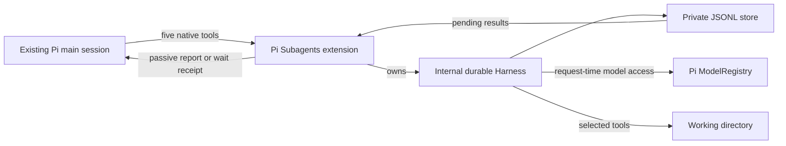

# Experimental durable Subagents

Durable mode keeps reusable subagent conversations and pending results on disk. It is an opt-in backend of Pi Subagents, not a separate extension, `/durable` export, or replacement for the main Pi session or model loop. The default process-backed jobs, attachments, and bidirectional messaging remain unchanged when `durable` is `false` or absent.

**Experimental:** this backend has a different tool contract and narrower capability support. It requires Linux, util-linux `flock`, and a real persisted Pi conversation. Recovery does not guarantee exactly-once external effects or power-loss durability. The main agent must still verify subagent claims against files, diffs, and deterministic checks.

## Settings and prerequisites

Manually edit either extension-owned file:

| Scope | File |
| --- | --- |
| User | `getAgentDir()/pi-subagents.json`, normally `~/.pi/agent/pi-subagents.json` |
| Project | `<cwd>/.pi/pi-subagents.json`, honored only when `ctx.isProjectTrusted()` is true |

```json
{ "durable": true }
```

`getAgentDir()` is Pi's public agent-directory API; the project directory name comes from Pi's `CONFIG_DIR_NAME`. These settings do not belong in Pi's `settings.json`.

The only backend setting is `durable`, a boolean with default `false`. Precedence is defaults, then user settings, then trusted project overrides. A trusted project can explicitly set `false` to override user-level `true`. An absent file or absent field adds no override. Unknown fields are ignored. Invalid JSON, a non-object document, a non-boolean `durable`, an unreadable file, or a final-component symlink or special file is ignored with a warning. The loader does not create settings files or overwrite invalid content.

Settings are read at `session_start`, including reload and session replacement. The selected tool family stays fixed within one extension runtime. Run Pi's `/reload` after changing the backend; a session replacement that detects a different backend requires reload before work can continue. The `/subagents settings` UI changes process-widget preferences only; edit `durable` manually. There is no backend-switch command or extension-specific environment flag.

Before enabling durable mode:

1. Use Linux with `/proc` and a trusted util-linux `flock` executable on `PATH`. Other operating systems and missing or incompatible `flock` are rejected before the durable store is created or opened.
2. Keep Pi session persistence enabled. `--no-session`, in-memory sessions, and files containing only a session header or custom entries cannot own durable work. A real user or assistant conversation must be present on disk. A new normal session initializes durable storage on first use, after that conversation exists.
3. Use a linear session in the same working directory with the same project-trust state. Read [session ownership](#session-ownership-and-recovery) before using tree navigation or forks.
4. Select an available physical chat model with current configured authentication. Virtual-model profiles are rejected because the public registry cannot resolve and authorize their physical route before recovered effects start.
5. Use the dependencies selected by this package's [manifest](../package.json) and installation lockfile. The manifest, not a version number in this guide, defines the selected durable baseline.

## Native tools

Durable mode registers these five tools in the main Pi session. They replace only this extension's default job tools for that loaded backend, not Pi's main agent tools.

| Tool | Parameters | Result or action |
| --- | --- | --- |
| `subagent_spawn` | `task`; optional `tools`, `skills`, `extensions`, `thinkingLevel`, `timeout` | Start a persistent conversation; return `conversationId` and a request receipt immediately. |
| `subagent_send` | `conversationId`, `message`; optional `whenBusy` | Assign more work to a running or idle conversation; return a request receipt. |
| `subagent_stop` | `conversationId` | Stop current and queued work without closing the conversation. |
| `subagent_status` | optional `conversationId` | List owned conversations or inspect one, with `running`/`idle` and latest request outcome metadata. |
| `subagent_wait` | `conversationId`; optional `timeout` | Wait for already submitted work and return its saved outcome and result. |

`conversationId` is a decimal string, such as `"2"`, scoped to the current main session's private store. Use the returned value; do not convert it to a global agent identifier or use it in another session. Spawn and send also return `requestId` metadata for correlation. That field is not an accepted argument to durable send or wait and is not the default backend's question-response protocol.

### Spawn and capabilities

A minimal spawn call is:

```json
{
  "task": "Read README.md and report any unclear setup instructions. Do not change files.",
  "tools": ["read"]
}
```

Omitting `tools` selects only `read`. An empty list selects no work tools. Supported native coding tools are `read`, `write`, `edit`, `bash`, and `powershell`; duplicate names are removed. These are the durable runtime's coding tools, not a child Pi CLI's complete tool set. Shell tools require their corresponding executable in the execution environment.

Nonempty `skills` and `extensions` are explicitly rejected. Empty arrays are accepted but attach nothing. `grep`, `find`, `ls`, and `codemode` are explicitly rejected, not silently removed or replaced. This does not change the default backend's `read`, `grep`, `find`, and `ls` loadout or its attachment support.

Spawn selects the main session's current model and thinking level. `thinkingLevel` accepts the same named controls as the default spawn interface: `off`, `minimal`, `low`, `medium`, `high`, `xhigh`, and `max`, subject to model support. There is no per-conversation model override. Later sends retain the conversation's saved model, thinking level, tools, working directory, and trust profile; they cannot expand its capabilities.

Spawn's optional `timeout` bounds its initial assignment. Wait's optional `timeout` bounds only that waiter. Both use seconds, accept finite values greater than zero through 2,147,483.647, and have no default. The durable execution deadline is persisted when execution starts and remains in force across suspension. Send does not accept a timeout or change the initial assignment's deadline.

Tasks must be nonempty text without NUL and fit within 50 KiB of UTF-8. Send messages use the existing 48 KiB and 1,992-line message limit. Saved result and error text is bounded; this interface is not an unlimited transcript export.

### Send and reuse

Use `subagent_send` for another assignment in the same conversation:

```json
{
  "conversationId": "2",
  "message": "Now check whether the installation example matches package.json.",
  "whenBusy": "followUp"
}
```

Replace `"2"` with the actual returned ID. When the conversation is busy, `whenBusy: "steer"` is the default and directs the message into current work. `"followUp"` queues it after the current answer. An idle conversation accepts another assignment without a new spawn.

Durable children do not receive the default backend's child `subagent_send` and `subagent_wait` communication tools. There is no child-originated bidirectional `requestId` question protocol in this backend. Put necessary scope, authorization limits, and reporting requirements in the assignment.

## Waiting and completion delivery

A wait captures the conversation's current request frontier: all assignments submitted when that wait begins. Later sends do not extend it. The wait completes after those captured requests settle and their captured stop work is complete. It returns the outcome and saved result of the latest captured assignment, not every answer or necessarily the newest assignment at return time.

A wait timeout returns `timedOut: true`; caller cancellation fails only the waiter. Neither cancels the assignments. Wait again when needed, or use `subagent_stop` to stop work.

Conversation state and work outcome are separate:

| Field | Meaning |
| --- | --- |
| `state: "running"` | Work or stop processing remains, or a nonsuppressed result still awaits main-session acknowledgement. |
| `state: "idle"` | No such work or pending report remains; the conversation can receive more work. |
| `outcome` | A captured request's `completed`, `failed`, `cancelled`, or `timed_out` result. |
| `timedOut` | Whether this wait expired, independent of an assignment's `timed_out` outcome. |

A wait can return `outcome: "completed"` while `state` is still `"running"`, for example before the tool result is persisted and its report acknowledged. There is no `closed` conversation state or close operation. Status exposes IDs, state, latest outcome metadata, and a top-level `deliveryPending` diagnostic; it omits task text, transcript content, selected tools, and credentials. `deliveryPending: true` identifies a retained publication error, not active model work. `false` is not proof that every report is delivered.

A successful finalized `subagent_wait` tool result carries a private receipt in its `details`, not its model-visible content. The extension verifies that receipt against the persisted main-session file before acknowledging its covered reports. A returned JavaScript value, a cancelled or failed tool result, or a memory-only append is not proof of delivery. The receipt covers only the answer included in that tool result, not every request the wait awaited. Earlier distinct answers still require their own reports. Once the disk-backed wait receipt covers a report, the extension does not add a duplicate automatic completion message for it.

For results not received through wait, the extension publishes a passive completion message when the main session is idle. Publication and acknowledgement are serialized and checked against the owning session and its disk receipts. Reports remain pending when the main session is busy or persistence cannot be verified. A completion does **not** start an idle main-model turn: this preserves the default backend's completion cost policy. A later main turn can use the appended result, or the main agent can explicitly wait while already working. Reports include their request ID so an earlier answer can be distinguished from a later assignment.

If publication has uncertain persistence, the extension retains the report and refuses a blind resend in that publication epoch. A delivery error alone does not disable explicit wait. A memory-only receipt or other mismatch with the main-session file does fail the disk preflight, including for wait, until the actual Pi session is reopened. Close Pi and reopen the saved session when a disk receipt is missing; `/reload` retains the same in-memory session manager and cannot repair such a receipt. A queued `sendMessage` call alone is not an acknowledgement. A report receipt proves local transcript insertion, not model consumption or correctness of the result.

## Stop semantics

`subagent_stop` is run-scoped and leaves the conversation reusable. It records a persistent stop intent for the work present when that invocation is accepted, cancels queued and current assignments, and suppresses old reports that have not been delivered. New sends are rejected while stop processing is in progress; retry after it completes.

Recovery honors an accepted stop before restarting generation. Replaying the same stop tool invocation joins that captured stop; it cannot cancel newer work submitted after the original stop completed. A new stop invocation can target that newer work. Stop returns the conversation's actual current state, so replay can return `"running"` when newer work exists.

Stop does not erase history, undo file or network effects, or retract a report already delivered to the main session. A cancelled or timed-out assignment remains available through wait/status metadata; its automatic completion report is suppressed. Execution timeout uses this stop path and can also cancel other queued or active work in that conversation. To stop work before disabling durable mode, explicitly stop each active conversation; changing the setting is not a persistent stop request.

## Session ownership and recovery

State lives under:

```text
getAgentDir()/pi-subagents/<private-binding-hash>/
```

The binding includes the main Pi session ID, canonical session-file path, and canonical working directory. The store contains execution history, request outcomes, pending reports, and recovery policy. It is private local state, not a project file or a portable conversation handle.

The extension uses an internal `@earendil-works/pi-durable` `Harness` with JSONL storage. Public Pi APIs provide main-session admission and delivery receipts, and the public `ModelRegistry` supplies model requests. The main session continues to own its normal conversation and model loop.



Only one cooperating local process can own a store. Ownership uses the Linux kernel's file-descriptor `flock` lock, acquired through util-linux `flock`, and held by the actual Pi process. There is no stale-lease timeout, PID takeover, or separate lock-holding daemon. Normal cleanup closes the owned descriptor; actual parent-process `SIGKILL` also releases it. The persistent `owner.lock` file is not a stale lease. Do not delete, rename, or replace it or its store to bypass a live-owner error.

The store must be owned by the current user with mode `0700`; `owner.lock` must be an owned regular `0600` file with one link. Symlinked store path components and unsafe ancestor directories are rejected. The advisory lock protects cooperating processes, not hostile code running as the same user or root. Use a local filesystem with Linux lock semantics; this is not a distributed storage protocol.

Reload, session replacement, and shutdown suspend durable execution, release waiters and owned resources, and release the store lock. They do not permanently cancel accepted work. Reopening the same persisted linear session with compatible policy can resume it and recover pending results; no detached worker continues while Pi is closed. Expired saved deadlines and accepted stop intents are handled before recovered model work starts.

Same-file branched session trees are refused, rather than assigning one store to competing histories. Tree navigation suspends this backend; use a new unbranched fork or session to continue durable work. Normal main-session navigation remains available, and the default backend is unaffected. A fork into a new Pi session gets a new store and does not inherit ownership of source agents, even if its copied transcript contains source receipts. Linear compaction retains raw admission and delivery receipts; it need not retain all report text in model context. Compaction is not a reason to republish an acknowledged result.

Recovery policy in `policy.json` records the state schema version, exact installed `pi-durable` version, session binding, and saved model/tool/cwd/trust profiles. A version or binding mismatch blocks recovery before opening execution storage; profiles are rechecked for workspace, trust, model availability, and configured authentication. This pins the declared installed runtime baseline for recovery; it does not bundle code or verify code hashes. There is no automatic schema migration or reset. Restore the compatible runtime or required model/authentication setup, then reload or reopen as instructed. Do not edit policy or execution files to force recovery. If an interrupted tool reply is missing, inspect status before issuing a fresh assignment: a missing reply does not prove the work never started.

An internal task fault suspends the backend and releases its local resources instead of leaving an unlimited wait pending. An explicit reload or reopen can reconstruct a pending reporter or stop task with compatible code. Recovery retains the accepted request ID, execution deadline, and captured stop boundary; it does not admit a new assignment or run a live retry loop. Unrecognized task records or mismatched ownership block recovery without resetting the store.

## Security and model access

Durable mode is not a sandbox or a separate Pi child process. Native tools run with the host Pi process's user permissions. `read` can access files outside the working directory when the account can read them. `write` and `edit` allow mutation; `bash` and `powershell` allow unrestricted command execution. Internal durable tool execution is not the main Pi tool loop; do not assume main-agent extension tool hooks or attached permission policies protect it. Use operating-system isolation when required, and give parallel writers disjoint ownership or external workspace isolation.

Assignments, inspected data, transcripts, and results can be sent to the selected provider and persist in the private store and main Pi session. The store is not encrypted, and private permissions do not protect data from other code running as your account. Review both stores before sharing or backing them up. Subagent output is untrusted evidence, not user permission for writes, shell execution, credential access, or other privileged actions.

Model and authentication access uses the main session's public `ModelRegistry` at request time. The adapter does not copy provider keys, OAuth tokens, or a second credential store into durable policy. Providers registered in the parent can be used while available there; recovery requires them to be registered and authenticated again. This does not make credentials inaccessible to fully privileged tools or code.

Deferred provider requests, polling, and cancellation APIs that cannot be represented through the public registry are explicitly unsupported. Virtual-model profiles are not supported by this backend. Select a physical model; a keyless virtual provider's configured status is not proof that its physical route can be authorized before recovery. Main-agent-loop routing, retry reasons, and branch-scoped router state are not inherited. No private main `AgentSession` is created or replaced for model access.

## Compatibility and recovery limits

This is not full default-backend parity. Durable mode has no default child messaging broker, attachment loader, `grep`/`find`/`ls`, codemode, or legacy active-job widget. Use native status and wait results. It does not migrate default process-backed jobs or the older retained-agent interfaces.

The store currently admits up to 32 conversations and eight requests with no outcome. There is no close/delete tool or default-backend terminal-record expiry policy. Retained conversation context can grow; the internal Harness disables automatic compaction and automatic model retries. Do not assume that main-session context, retry, resource-discovery, or UI policies are inherited by the internal Harness.

Persisted operation identities and delivery receipts prevent duplicate admissions and reports for matching retries within their ownership scope. They do not form a transaction with external services or the main Pi session file. A crash can repeat an unfinished provider request. An interrupted tool not declared replay-safe produces an `interrupted` error instead of an automatic rerun, but a model can still request another call. External shell processes and effects can outlive parent-process `SIGKILL`; releasing the store lock does not stop them or roll back their effects. Main Pi disk receipts establish local persistence, not a power-loss guarantee. Stop cannot undo an effect that already occurred.

For the authoritative platform contracts, see Pi's [Extension API](https://github.com/earendil-works/pi/blob/main/packages/coding-agent/docs/extensions.md), [SDK session and registry guidance](https://github.com/earendil-works/pi/blob/main/packages/coding-agent/docs/sdk.md), [virtual-model routing](https://github.com/earendil-works/pi/blob/main/packages/coding-agent/docs/virtual-models.md), and [durable Harness documentation](https://github.com/earendil-works/pi/tree/main/packages/durable). The installed dependencies and this package's manifest determine the supported baseline; upstream APIs do not imply that every upstream feature is exposed here.
