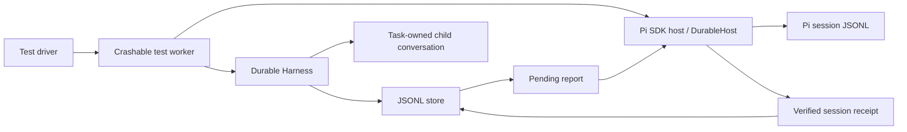

# Durable subagent validation

> Historical test-only checkpoint. The decision, versions, counts, and remaining gates below describe the earlier fixture, not the current extension. The built-in backend uses a different ownership and lifecycle implementation; see [current durable guidance](../docs/durable.md), `durable-runtime.test.ts`, `durable-package-restart.test.ts`, and the production failure regressions. The fixture's permanent close and supervised lease are not production behavior.

## Historical decision

**No-go for production integration; the test-only lifecycle proof passes.** Public durable APIs can preserve a reusable agent, its runs, child conversation, requests, and pending reports across process restart. They do not provide the current Pi Subagents attachment contract or a process-owner lock.

The published runtime, tools, entrypoints, manifests, and defaults are unchanged. These tests do not enable durable subagents in Pi. Follow-up approval is required before changing isolation, supported capabilities, recovery ownership, or report-delivery behavior.

## Scope and environment

The proof uses only synthetic providers, temporary stores, public Pi exports, and package-owned test fixtures. It does not contact a model provider or read user sessions. Root Vitest setup sets `PI_CODING_AGENT_DIR` before imports; the worker sets it before its lazy SDK-host import. Worker environments contain only `PATH`, not inherited provider credentials.

Inspected resolution on the test host:

| Component | Resolution |
| --- | --- |
| Node | `26.11.1` |
| Pi durable, AI, coding-agent, agent-core, codemode, Chord | `1.2.0` |
| Durable/Pi minimum Node engine | `>=22.19.0` |
| Durable status | Experimental; API can change without notice |
| Durable storage | JSONL, `{ fsync: true }`; process-crash tests, not power-loss tests |

The exact upstream package versions are observations, not a promise of compatibility with future releases. The root manifest and lockfile remain authoritative.

## Fixture boundaries

The crashable worker contains a durable coordinator and fresh child conversations. Its lazy SDK host uses a real `AgentSession`, `SessionManager`, and Pi session file. This isolates the fixture from the test runner; it does **not** establish one fresh Pi CLI process per subagent.

| File | Responsibility |
| --- | --- |
| `durable-fixture.ts` | Agent lifecycle, durable anchor/message tasks, synthetic tools, state and outbox |
| `durable-worker.ts` | Test-only IPC and controllable checkpoints |
| `durable-driver.ts` | Worker readiness, request deadlines, process termination and supervised lease recovery |
| `durable-worker-host.ts` | Lazy real SDK host in the crashable worker |
| `durable-lifecycle.test.ts` | Fresh-process lifecycle, messaging, ownership and end-to-end report tests |
| `durable-host.ts`, `durable-host.test.ts` | Pi admission/report receipts, lifecycle guards, branch and prefix tests |
| `durable-upstream.test.ts` | Upstream storage, definition, model and tool-replay failure branches |
| `durable-host-audit.md`, `durable-upstream-audit.md` | Detailed source branches and focused verification evidence |

There is no custom scheduler. The coordinator uses public durable tasks. A conversation-owned background anchor owns each child conversation and its main-request tasks. Returning the spawn receipt does not end that anchor. No factory loads or starts this proof in the production extension.

## Public API and compatibility audit

| Need | Public API or finding |
| --- | --- |
| State and lifecycle | `defineDoc`, `defineTask`, `defineExtension`, `createRegistry`, `commit`, `snapshot` |
| Fresh child and ownership | `Tx.createTask`, `Tx.createConversation`, `configure`; background anchors must be conversation-owned |
| Input and recovery | `Conversation.submit`, stable `requestId`, `Harness.submission`, `Submission.wait` |
| Observe | `inspect`, `context`, `watchDoc`, `getTask`, `waitForTask` |
| Suspend host | `Harness.close`; this signals and joins invocations without writing cancellation outcomes |
| Explicit close | No upstream permanent-close API; the fixture persists close intent, aborts the anchor, waits for terminal cleanup, then preserves the closed tombstone |
| Before recovery | `Harness.open` can reconcile records; authorization must precede opening, not only `resume` |
| Scheduling | Resume is Harness-wide; submit, wait and some cancellation/idle APIs also enable it; `abortTask` alone does not |
| Normal admission in one custom transaction | Not available; `Tx.createSubmission` is raw storage, not normal admission |

Agent/conversation/anchor creation and assignment intent are atomic. A durable dispatch phase then calls normal `submit` outside the commit. A crash between submission and the next task checkpoint reuses the same request. Payload equality is checked by the fixture because upstream submission deduplication does not compare input content.

| Current Subagents capability | Durable result |
| --- | --- |
| Model and thinking level | Durable agent fields exist; the proof uses a synthetic physical model. Live-provider and virtual-model routing parity are unverified. |
| cwd and selected tools | Durable environments and explicit tool selections exist. Real filesystem/cwd parity is not exercised by this proof. |
| Default `read`, `grep`, `find`, `ls` | Not equivalent: durable does not supply the current `grep`/`find`/`ls` defaults. |
| Codemode | Separate durable extension and sandbox; current coding-agent codemode loading is not an adapter. Sandbox compatibility is unverified. |
| Skills, standard Pi prompt and project context | No automatic equivalent; the fixture deliberately supplies its own prompt. |
| Trusted local coding-agent extensions and providers | Different extension APIs; no automatic attachment or lifecycle bridge. |
| Credentials | Supply a compatible Pi AI `Models` implementation; do not persist API keys or broker tokens. Real OAuth/runtime-only credentials are unverified. |
| Bidirectional messaging | Fixture-owned durable request records/tasks prove representative recovery; they do not establish compatibility with the existing loopback broker protocol or public tool schemas. |
| Process isolation | Fresh conversations are verified. The current fresh Pi CLI process per agent contract remains unresolved. |

The audit used installed public types and the actual scheduler, task, tool, agent, generation, JSONL and Pi session implementations. Private implementation paths were inspected, never imported or modified. There is no dependency on another extension; Langfuse tests were only a reference.

## Recovery evidence

Each named scenario has deterministic test assertions. Crash tests terminate a real worker and reopen the same files in a new process; they do not reuse a Harness or retained JS state. Readiness and committed checkpoints control faults. No fixed sleeps or raised per-test timeout are used.

| Scenario | Result and boundary |
| --- | --- |
| Reuse | Same agent, anchor and child conversation; distinct run/report IDs; task B sees A's committed context, not main's history. Standby waits for all accepted message tasks and child work; completion, cancellation and restart during draining all permit safe reassignment. |
| Admission ambiguity | Kill before admission, after its commit, and after child submission but before dispatch checkpoint; replay produces one agent, run and report. |
| Running restart | Orderly shutdown and SIGKILL during generation and safe/unsafe tool execution recover their committed identities. |
| Standby restart | Orderly shutdown and SIGKILL preserve standby; explicit scheduler resume makes no model request until a new assignment. |
| Failure/cancellation | Failed, cancelled and explicitly timed-out runs remain inspectable and permit the next assignment. Cancellation before dispatch makes no provider request. Persisted cancellation is enforced before recovered generation/tool execution; a delayed caller cannot abort a newer assignment. The timeout case injects the timeout decision; persisted wall-clock deadline enforcement remains unverified. |
| Wait cancellation | Cancels only the waiter; the run continues and can later be awaited. |
| Busy/conflicting requests | Rejects a different active assignment and conflicting payload reuse; identical request replay returns the existing identity. |
| Explicit close | Running and standby agents become permanently closed; repeated close and reopen cannot admit work. |
| Close races | Close intent wins over late completion and reassignment; a crash after close intent causes cancellation before pending user work is scheduled. |
| Child-to-main request | A question remains running after a process kill; the first persisted answer wins. Unknown, late and closed requests fail visibly. |
| Main-to-child request | A durable message task resubmits by stable request ID after a kill at delivery; the child sees one message and the saved answer remains available. |
| Interrupted child wait | Main steering releases the child wait without fabricating an answer. The question remains pending until the owning run ends, then receives an explicit cancelled status. This synthetic flow is not the existing communication-tool contract. |
| Pending request close | Anchor cancellation records cancellation for requests in both directions. |
| Result/report gap | Kill after submission completion but before application outbox publication; collecting the same completed submission rebuilds one report without another provider call. |
| End-to-end outbox | Kill before delivery, after Pi session append but before durable acknowledgement, and after acknowledgement. Reopen actual Pi and durable files; reconcile to one Pi report entry and the correct acknowledgement. |
| Host lifecycle | Real public `AgentSessionRuntime` new/resume/fork/shutdown and partial-startup tests dispose stale hosts; delayed publication cannot acknowledge into a replaced session. |
| Prefix | Normalized prompt/tool declarations and serialized earlier messages remain prefixes across ordinary main/child turns and reopen/redispatch. No provider cache-hit guarantee is claimed. |
| Resource cleanup | Orderly shutdown exits with code 0, no signal fallback, and no remaining timer/server/filesystem-watcher resources in the worker's shutdown snapshot. Concurrent SDK-host initialization is rejected; shutdown joins both pre-create and post-create initialization. Shared checkpoint release wakes every waiting agent. Every test driver reaps workers and removes temporary stores. |

## Ownership and recovery policy

The fixture acquires an exclusive `wx` lease **before** binding validation and durable storage open. A competing worker fails without opening the store. Stored session, branch, capability and code identifiers must exactly match supplied fixture policy. Revoked trust or absent credentials fail before Harness initialization. Failure tests compare store bytes before and after blocked opens.

A settled primary submission is not necessarily an idle agent: a previously accepted main request may still own child work. The anchor seals new message admission, drains accepted requests and child execution, then publishes standby. Cancellation can interrupt that drain; a crash repeats it safely.

A run cancellation is an intent, not an early terminal outcome. The durable anchor stops its owned message tasks and child work before publishing standby. Startup abort-marks work covered by persisted close or cancellation intent before any progress API. Callers wait for the targeted run's outcome; they do not abort a conversation from a stale snapshot.

On normal shutdown the owner releases its lease. A supervisor can clear a matching lease only after it observes that exact worker exit. An unknown stale lease is left intact; there is no PID-only takeover or lease expiration. **If the supervisor/main process itself dies, unattended stale-owner recovery is blocked.** This is a safe refusal, not full implementation of automatic Pi crash recovery.

Policy fields are explicit synthetic fixture inputs, not automatic hashes or an implemented mapping from every real Pi session/fork/trust transition. Real host tests independently prove branch receipt visibility and stale publication rejection. Production needs an approved rule for session replacement, branch ownership, lock recovery, capability/code validation, and resume consent.

## Delivery guarantees and limits

The fixture commits each run outcome and pending report together. The prior durable model result can be committed earlier; a replayable collect phase closes that gap. Main publication uses one custom-message entry containing both content and stable report identity. Before acknowledging the durable outbox, `DurableHost` reopens the real Pi session file through public APIs and verifies the exact receipt.

Important upstream decisions are covered by regression tests:

- A custom-only/new or in-memory Pi session is not an acceptable durable admission target.
- Pi indexes session entries before its file append; a failed append can leave a memory-only receipt. The host fails closed and requires disk reopen instead of trusting it.
- `pi.sendMessage` is void and can queue delivery. Even awaiting `sendCustomMessage` can only queue in some states. The helper defers publication until idle and verifies disk presence; it does not treat a queue operation as acknowledgement.
- `agent_settled`, not `agent_end`, is the deferred-trigger boundary. Receipt persistence does not mean the main model read the report or was awakened.
- Compaction can retain a raw branch receipt while removing report content from projected model context. Receipt deduplication must not reinsert content into the earlier prefix.
- Bare branch navigation is not itself a persisted checkpoint. Forks have separate session identity and cannot adopt the original agent's receipts merely by inheriting entries.
- There is no atomic transaction across the two stores, no multiwriter Pi session guarantee, and no public fsync acknowledgement. Tests establish process-visible reopen and stable-ID reconciliation, not power-loss or external exactly-once delivery.

## Failure and privilege audit

`durable-upstream.test.ts` covers missing definitions, incompatible task versions, storage failure/SessionFailed, torn versus complete malformed JSONL lines, missing extensions/tools, missing model/provider/auth, and tool-replay branches.

Missing selected extension/tool names are silently omitted upstream. Safe replay skips current argument validation and `beforeTool`; both stored and current replay policies must be safe to rerun. Thus a new hook cannot be the sole trust barrier. The host must validate capabilities and code before any progress API. Same-version code replacement has no general upstream fingerprint check.

Safe test effects use a stable external file key; unsafe interrupted effects are not repeated. An interrupted outcome does not undo an already completed external write. Generation stores `settings.stream` in checkpoints, including headers/metadata: putting authorization or broker secrets there would persist them. The proof uses no such settings or real secrets.

JSONL torn-tail and complete-malformed-line tests cover representative recovery branches, not every confirmation, sidecar reclamation or disk-corruption case. `{ fsync: true }` is not a tested power-loss guarantee; inspected marker flush behavior is not universal per commit. Storage failures stop the Harness rather than reset user data.

## Verification

Execution results are recorded after final validation below. The per-file audit notes also retain their earlier focused runs; they are not substitutes for root gates.

- Proof suites: **118 tests passed** in the final root run: 53 lifecycle, 39 host, and 26 upstream. The final separate lifecycle run also passed all 53 cases, including the independent-review regressions.
- Root `npm run check`: passed after all source corrections (builds, Biome, boundaries, workspace typechecks).
- Root `npm test`: **11,187 passed, 2 skipped** across 665 passing files and one skipped file; 249.53 seconds. The skipped cases are existing repository cases, not new durable proof tests.
- Test-source `tsconfig.test.json` no-emit check and focused Biome checks passed. No per-test timeout was increased.
- Package-directory build passed. A real CLI RPC smoke loaded `./packages/pi-subagents`, returned a successful `get_state` readiness response, and exited with code 0 after stdin EOF. No provider request was sent.
- Semantic audit: lifecycle cleanup, stale continuation, state/outbox ordering, invalid-store preservation, branch ownership, prefix stability, explicit privilege selection and public-import boundaries reviewed against `docs/extension-conventions.md`, `docs/extension-settings.md`, and `AGENTS.md`.
- No settings, custom UI, package metadata, publishing behavior or production entrypoint changed; pack, Changeset, TUI keybinding and live-provider smokes are not applicable to this test-only change.

## Historical integration gates

1. Choose and test a production owner-lock/recovery mechanism that survives the main process dying; do not weaken the safe stale-lease refusal silently.
2. Decide whether to preserve one Pi process per agent, and approve any capability changes. Implement or explicitly exclude skills, attached extensions/providers, current tools, virtual-model routing and codemode.
3. Bind durable stores to actual Pi session/branch identity, trust and compatible code before open; choose what session replacement and forks do.
4. Define production report delivery, idle-model wakeup, timeout deadlines and retention without claiming stronger receipt guarantees than public APIs provide.
5. Integrate only in a separate approved production plan. The existing runtime remains active.

At this checkpoint, the validation plan remained open and did not authorize production integration. The later built-in implementation and its verification are separate from these historical proof results.
