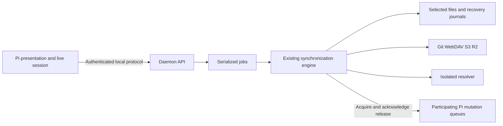

# Ownership and safety contract

This package owns the existing Pi Sync engine and a root-bound local service. Process lifetime is not permission to transfer files or invoke a model. The current implementation is under development; this document does not establish release readiness.

## Boundaries



`src/index.ts` exposes the lightweight IPC client, wire types, and hashes. It must not import the service, backend, watcher, or model runtime. `src/engine-service.ts` dispatches a closed operation set. `src/engine/host.ts` defines the engine's process boundary. The daemon never imports another extension or loads user extensions.

`@narumitw/pi-sync-daemon` is a non-extension library and Node service in `packages/pi-sync-daemon/`, with `pi-sync-daemon` as its executable. The `pi-` prefix identifies its Pi Sync scope; it does not declare `pi.extensions`. The rename preserves existing IPC namespaces, authorization digests, and settings/state formats. The Pi client retains its own UI, commands, and status protocol.

## Authoritative documents

| Document | Writer | Coordination and recovery |
| --- | --- | --- |
| `pi-sync.json` and compatible legacy configuration | Daemon settings writer | Existing complete read/validate/update queue, cross-process config lock, private same-directory replacement, exact source identity/bytes check |
| `settings.json` selected by synchronization | Daemon apply transaction; Pi core remains an independent writer | Participating public file queues plus the actual Pi settings-file lock; revalidate preimages inside ownership |
| Selected settings/resources/sessions | Daemon apply transaction; tools/editors remain independent writers | Public client queue reservations, protected-session union, original preimages/backups/journals |
| `pi-sync/`, legacy `.pisync/` | Existing engine state writer in daemon | Existing operation lock, explicit migration guard, journal recovery; no automatic destructive migration |
| IPC identity/client ledger | Local server | Private root-bound namespace; atomic identity publication; ambiguous and orderly retired live sessions survive restart |
| `pi-sync/daemon.json` | Daemon consent owner | Bounded private atomic publication in one event-loop turn; exact policy/config/binding checks after review; interactive binding changes durably revoke prior unattended grants |
| `auth.json`, `models.json` | Public Pi SDK APIs only | No private credential parsing or parent credential copying; settle SDK credential writes before exit |

Read-only display state is not a second settings writer. A client proposes a validated new document with the exact source fingerprint; the authoritative writer checks the fingerprint under its settings lock. A stale editor must reopen rather than merge a stale approval automatically. Invalid existing JSON remains intact. Unknown fields remain in the proposed source clone.

## Context inventory

| Former Pi dependency | Engine host boundary | Source |
| --- | --- | --- |
| `getAgentDir()` | Explicit canonical service root | `engine/host.ts`, `engine/snapshot/session-paths.ts` |
| `ctx.cwd`, session directory/current session | Plain client facts, generation-bound getters | `protocol.ts`, `service-host.ts` |
| `ctx.isIdle()` | Current participating-client facts, not a captured Pi context | `service-host.ts` |
| Protected sessions and missing-settings guard | All live client PIDs, including retired clients; separate from active participation | `server.ts`, `service-host.ts` |
| `ctx.ui.notify`, status | Bounded events | `server.ts`, `service-host.ts` |
| Confirm/select/exact merge review | Job-bound callbacks; revalidation after response | `service-host.ts`, `engine/ui/merge-review.ts` |
| Reload | Explicit client callback after the existing user confirmation | `engine/sync/sync-mutations.ts` |
| `ctx.model`, `modelRegistry.streamSimple` | Explicit selected model identity/signature; independent public SDK runtime | `model-signature.ts`, `resolver-host.ts` |
| `withFileMutationQueue` | Participating Pi queue grants plus daemon-local queue | `service-host.ts`, Pi adapter `daemon/apply-gate.ts` |

Terminal formatting utilities are not interactive components. No daemon-owned menu, editor, or Pi custom UI is permitted. Exact review content stays data until the client renders it with its original UI and sanitization rules.

## Decision and failure matrix

| Branch/equivalence class | Required outcome | Verification |
| --- | --- | --- |
| First client / simultaneous clients | Canonical root startup lock; one lifetime owner; readiness identity matches version/root/instance | Process singleton tests |
| Distinct canonical roots / root aliases | Independent owners / same canonical owner | Server and process tests |
| Existing healthy identity | Connect; do not spawn | Handshake tests |
| Existing live but unreachable owner | Refuse a second owner | Startup failure tests |
| Dead known owner / another instance endpoint / replaced endpoint or ancestor | Use a fresh private instance namespace / leave old entries intact / retire the current namespace and retain unknown entries before Node closes | Endpoint tests |
| Incompatible version/root/instance/token | Reject before any operation | Protocol tests |
| Same operation ID, identical input | Return existing result; never redispatch | Replay tests |
| Same ID, changed input / expired result | Refuse; reconcile existing journal | Replay/eviction tests |
| Cancel before submit / queued / waiting for review | Tombstone / abort before dispatch / abort UI callback | Cancellation tests |
| Cancel or detach after commit | Finish existing journal/publication bookkeeping, not a second publication | Recovery tests |
| Active sessions in two clients | Protect their union, including alternate session roots | Multi-client apply tests |
| Lost connection with live PID / timeout | Retain protection and queue uncertainty; not proof of exit | Ambiguous-disconnection tests |
| Confirmed daemon exit | Release quarantined Pi grants only after ESRCH | Apply-gate tests |
| Busy participating client / changed generation | Stop or refuse automatic work; invalidate stale approval | Lifecycle tests |
| Directional sync / remote-selection decision across IPC | Restore the typed decision for command and recovery routing; preserve the existing resolution menu | Actual daemon error-routing tests |
| Pi edit/write during apply, inside or outside the agent root | Hold the actual public Pi queue; recheck preimages | Real `createEditTool` race tests |
| Reviewed external session destination / different peer session roots | Reserve every participant's canonical target queues; do not restrict coordination to its current roots | Actual two-client Pi RPC pull tests |
| Client joins during queue grant, apply, or release | Delay attach publication through the full reservation lifetime; include the new client in the next batch | Admission tests for print, JSON, and RPC clients, nested writes, cancellation, shutdown, and hook re-entry |
| Pi core settings update, existing file | Share its `proper-lockfile` file lock | Settings writer race tests |
| Missing `settings.json` with a live Pi | Refuse creation; Pi's missing-file branch does not reread after lock | Missing-settings contract test |
| Arbitrary unregistered writer | Existing optimistic checks only; no universal filesystem CAS claim | Existing snapshot race suites and documented limitation |
| No authorized model / parent-only provider | Resolver unavailable; no fallback model or extension loading | Resolver-host tests |
| Different serialized model definition, including key order | Resolver unavailable; preserve conflict and legacy request-budget identity | Signature and provider tests |
| Missing independent credentials | Public SDK failure; no parent-runtime key extraction | Synthetic resolver tests |
| No resolver request / cancellation after credential runtime creation | Metadata uses memory credentials without auth refresh / settle already-started SDK credential writes before releasing owner | Resolver lifecycle tests |
| Model output / stale candidate / refusal | Candidate only / revalidate all evidence / retain budget and refusal policy | Existing agent suites |
| No registered live PID and no valid active-setup after-exit grant / explicit CLI start without clients | Fixed 30-second grace, then quiesce and drain before safe exit; no final sync or inference | Lifecycle timer and process tests |
| Registered live PID, including passive, disconnected, publishing, or retired clients / uncertain PID probe | Retain lifetime and session protection; detach or heartbeat loss is not proof of exit | Live-PID and lifecycle tests |
| Client arrives during grace or quiescing, before final closing boundary | Cancel automatic exit; preserve one owner through admission | Admission and reattachment race tests |
| Valid active-setup grant / temporarily unavailable provider or backend | Retain lifetime under existing consent, fingerprint, and binding rules; no new work permission or availability probe | Consent and monitor tests |
| Uncertain consent publication, failed revocation, or cleanup failure | Stay paused; retain evidence and repair/revoke before explicit restart, without restoring an older grant | Consent failure and shutdown tests |
| Recognized closing owner / next eligible interactive client | Bounded cancellable wait; prove old-owner exit before singleton replacement; passive clients never launch | Closing-owner startup tests |
| Print/JSON, no existing service / existing service | No launch / passive protection and automatic-work pause; never an implicit unattended grant | Bootstrap and actual-session-facts tests |
| Orderly exit / ambiguous disconnection / replacement handoff | Retain live-PID file protection without active participation / pause and retain protection / require matching published successor | Server, handoff, and native post-exit model tests |
| Config/model/consent changes during unattended review | Reject before publication, preserving new data | Consent tests |
| Interactive model/cwd/session-root changes after grant | Durably revoke older grants; reverting or restarting does not restore permission | Consent restart tests |
| Legacy continuous/agent options Off | Remain Off; service lifetime does not change policy | Policy regression suites |
| Validated foreground sync for the active setup | Retry a persistent Continuous block once without resetting calls or candidate attempts | Actual Pi RPC authentication-repair test; typed-failure accounting tests |
| Other setup / cancelled or replaced origin / disabled policy / shutdown | Never force an unrelated or stale retry; retain intent while only busy | Monitor lifecycle and setup-scope tests |

The source-linked matrix is the audit contract, not a list of already completed checks. The implementation plan records actual results separately.

## Automatic service lifetime

The daemon owns lifetime for one canonical agent directory and its registered client PIDs, not every Pi process on the machine. Live disconnected, passive, publishing, and orderly retired clients count. `/reload`, `/new`, fork, and resume do not close the shared owner while their Pi process remains alive. An empty participant list, detach, transport failure, or heartbeat timeout is not proof of process exit.

When no registered live PID remains and no valid explicit after-exit grant covers the active setup, start a fixed 30-second grace period. The same policy applies to a service explicitly started without clients. A client arriving before the final closing boundary cancels automatic exit. Grants for other setups, revoked grants, and stale fingerprints do not preserve lifetime. Temporary provider or backend unavailability does not itself revoke a valid grant. Lifetime checks reuse existing consent authority without calling a model, contacting a provider or storage, executing credential commands, or changing authorization. No setting, environment variable, or keep-alive flag controls this policy.

After grace, stop new automatic work and cancel cancellable work. Drain foreground and monitor work, committed writes, admission, queue-release acknowledgements, peer persistence, and owned callbacks before endpoint and owner-lock release. Do not add a closing sync or model request. Preserve journals, backups, request accounting, and existing transfer permissions. Recheck liveness, consent, generation, and ownership after asynchronous reads or drains; the final admission boundary must let an earlier queued attach win and make a later attach observe closing. Cleanup failure is not successful exit.

After quiescence, the authenticated final fence returns `RemoteError.name = "DaemonStoppingError"` to rejected admissions and handshakes on the existing version-1 protocol. `ensureDaemon()` recognizes this idle-stop error and waits at most 30 seconds for the recorded PID to exit before singleton startup. The lightweight public `waitForDaemonExit(identity, signal)` helper provides the same cancellable process-exit check for an attach race; it never kills the owner or treats lost contact as exit. Pi Sync retries only an unpublished connection, at most once, and does not replay submitted operations. A rejected first attach preserves this stopping error after local disposal when no callbacks or prior attachment can own grants; a failed cleanup transport remains available as the error cause. Other combined attach and cleanup failures remain aggregate errors and do not authorize a retry. `DaemonConnection.attach(signal)` cancels queued admission without stopping the shared owner; the signal does not own the established connection's lifetime. The next eligible interactive client or explicit command may start after proven owner exit. An incompatible identity, uncertain ownership, or unreachable live owner still fails closed. Print/JSON never launch a service. Manual stop and restart retain explicit behavior. Authorization uncertainty and failed revocation remain paused, not cleared by an implicit restart that could restore an older persisted grant.

A later command can reconnect after a cancelled or failed unpublished attach. First, Pi Sync confirms the old connection's detach and drain, then releases its local queue grants. It uses a fresh client ID and generation for the next connection. Daemon retirement records stay intact, so late requests cannot revive the old attempt. Failed cleanup blocks a new identity and operation; it does not release uncertain grants. A cancelled or submitted operation is never replayed by this recovery.

### Recovering expired contact

A running daemon can expire a Pi session's heartbeat after a computer sleeps. A
cleanup poll still returns callbacks and job results. Its optional version-1
`contact` field distinguishes `expired` from `active` and `inactive`. Only a
heartbeat expired by this daemon instance gets `expired`. A facts update from
the matching expired client returns `ClientContactExpiredError`. An older
service can omit `contact`, which does not authorize repair.

`DaemonConnection.resumeContact()` sends the same client's current facts to
the authenticated owner with `resume-contact`. The daemon retains the existing
participant, protects the live session, and fences publication with the same
admission gate used by attach. Deliberate pauses, handoffs, retired identities,
and peers loaded from disk are not eligible. Cleanup polling stays available
while admission waits. Unknown work outcomes and unconfirmed queue releases
block repair. Pi Sync supplies non-ready, busy facts during admission, then
publishes fresh facts after confirmation. The binding and consent checks still
apply. A failed or uncertain repair does not start a replacement owner, release
uncertain grants, or resubmit work.

## Repository lifetime smoke

After the repository build, run the standalone real-clock smoke from the repository root. It loads the built package directory through real Pi RPC, tests no-client CLI exit and last-Pi exit, restarts through the next eligible Pi, and retains an explicitly reviewed grant beyond the grace period. It uses only owned loopback provider/storage fixtures and preserves recovery bytes. It takes about two minutes; it is not a Vitest case.

```sh
npm exec -- tsc -p tsconfig.test.json
cp -R packages/pi-sync/test/fixtures node_modules/.cache/pi-extensions-test/packages/pi-sync/test/
node node_modules/.cache/pi-extensions-test/packages/pi-sync/test/idle-exit-cli-smoke.js
```

Do not rebuild while a smoke-owned daemon is running. Linux containers need an init process to reap detached children. This smoke does not verify native Windows behavior, terminal logout, physical power loss, or real-data cutover.

## Package upgrades

The authenticated `hello` response reports the running package build separately from its protocol
version. Older releases did not report a build. During active startup, the client holds the existing
startup lock, sends an authenticated `stop` to an older or unversioned owner, and waits for owner exit
and identity release. A private exit record survives cancellation and timeout. It keeps the PID
and, when available, a verified Linux process birth marker. For a marked owner, `ESRCH` confirms
absence only in the recorded PID namespace. A PID-only record still requires `ESRCH`. Later callers
use the record even if the old identity file is gone. Concurrent startup can wait for the drain
under a bounded, cancellable lock wait. The client checks the root again before launching a replacement.
It does not stop a newer build or start a replacement for an unreachable live owner. A retained unattended grant blocks
implicit replacement because a legacy owner cannot report a failed revocation. The client reads
consent under the state migration guard and releases it before sending stop. Passive attachment can
protect live sessions without starting a replacement or submitting sync operations on the old build.
An interactive session switch attempts the same protection-only attachment if the upgrade fails.

For a blocked pending upgrade, `repair-upgrade` checks exit under the startup and owner locks.
It revokes retained unattended grants under the state migration guard on all platforms. On
non-Windows platforms, it also syncs the consent directory before archiving the upgrade barrier.
Consent storage reserves one byte per retained grant so that revocation fits even for compact JSON
at the old size limit. Repair reuses the same private archive if interrupted. Normal startup
cannot clear an incomplete repair. The command does not start the daemon. Clean shutdowns still
clear the barrier without manual repair.

## Cross-process apply protocol

Acquire target queues in deterministic client-ID and canonical-target order. Each reservation has a job-bound ID and the peer's session generation. The client holds Pi's public queues until the daemon acknowledges completion with a `queue-release` callback. Release uses the reservation ID even if the grant response was lost. A cancelled UI callback does not release an acquired grant. If IPC disappears, hold the grant until explicit release or proof that its daemon process exited. A timeout is not such proof.

Batch reservations cover the transaction, not only each rename. `Execution.withParticipants()` fences attach publication from the peer snapshot through every grant, nested write, and acknowledged release. Nested reservations share that fence instead of reacquiring it. An attach queued behind an apply cannot finish startup until the reservation ends; the next batch includes that client. Cancelled waiters cannot publish later, and shutdown drains admission. Attach has no idle request timeout: a legitimate long apply must not let startup escape the fence. Transport disconnection cancels queued admission, and the Pi adapter pauses or disposes its partial connection without waiting for attach to finish. Other local requests retain their timeout. Monitoring hooks run outside the fence because they can await a queued background reservation.

Nested writes retain the transaction's queue ownership. Validate paths and canonical parents before reservation and recheck session protection and preimages after every await that can change them. The daemon's own Pi queue alone is insufficient.

A queue grant coordinates access; it does not authorize a filesystem write. The engine owns destination selection, transfer review, path preflight, and session protection. A reviewed session destination can be outside the agent directory and every participant's current session root. Each client must reserve those bounded absolute canonical targets without imposing a second current-root policy. Otherwise a directional root transition or a peer with a different session root can block an otherwise valid transfer.

Pi core's settings storage has separate existing-file and missing-file branches (`FileSettingsStorage.withLock()` in the installed SDK). Existing files lock before reading. Missing files compute the update before acquiring the file lock and do not reread afterward. Therefore creation with live Pi clients is refused, rather than claiming that the shared lock repairs this branch.

These guarantees cover cooperating registered clients. Unregistered old Pi versions, external editors, shell commands, and arbitrary extensions remain independent writers. Preserve conservative preimage checks, recovery evidence, and explicit upgrade preconditions.

## Explicit Continuous retry

Validated `/sync sync` and manager **Sync now** requests record the requesting client's last target setup. Startup transfers, status reads, and separate refusal retries do not set this intent. Keep intents separate across clients, and retain them while another client is busy. Cancellation, session-generation replacement, disabled Continuous policy, and service shutdown cannot carry an old intent into a later activation.

At the next eligible monitor start, recheck the origin, generation, and cancellation signal, then consume the intents once. Pass a matching setup name to the existing Continuous instance. The engine checks that name after its own settings read and lease acquisition, so an intervening setup change cannot force another binding. This bypasses a repaired persistent failure, not request accounting: existing calls, candidate attempts, leases, consent, and budget limits remain authoritative.

## Native runtime boundaries

Each POSIX instance binds inside an exclusively created 0700 directory; this parent, not a post-bind pathname chmod, is the access boundary. Node/libuv unlinks its original Unix socket pathname even when a regular file or ancestor symlink replaced it. After jobs and release acknowledgements drain, move the instance directory entry into a private retained container before closing Node's listener. Delete only the recognized socket and empty owned directories. Keep unknown files/symlinks for recovery. If the namespace cannot be retired, retain the live closed-to-work owner and require a permissions repair and explicit stop retry.

The model signature hashes the exact existing JSON serialization. Equal hashes preserve the engine's existing candidate keys and Continuous configuration identity; a definition with different serialization is unavailable, not a reason to reset budgets. Static metadata uses an in-memory credential store and no refresh. Only an actual resolver transport creates the public SDK credential runtime. Its final public `transformHeaders` hook revalidates capability and evidence after auth awaits, without returning header values to Pi.

Unattended permission stores a setup/policy digest and an independent model/location binding, not a former Pi context. Normal closed clients remain in the durable protected-session ledger while their PID is alive but do not block zero-client scheduling; ambiguous losses and replacement gaps do. `Execution.liveClients()` supplies file protection and the missing-settings guard, while `Execution.participants()` supplies queue reservations and work eligibility. An unrelated attach or daemon restart does not remove retired protection. Only confirmed PID exit or a matching published replacement releases the corresponding record. A consent publication failure latches automatic work off for that service instance and prevents automatic exit from silently clearing the barrier. Failed revocation or uncertain consent must not restore an older persisted grant through implicit restart; retain the paused owner and evidence, repair persistence, and revoke the retained grant before an explicit restart.

The resolver uses independently available agent-root `auth.json`/`models.json` configuration and the environment captured at service start. Credential commands execute non-interactively from the canonical agent root, not from a former Pi working directory. Handover must disclose this provider/account boundary; changing the service environment requires a restart. Parent runtime accounts, registered providers, and conversations are not copied.

Persistent credential semantics remain those of the supported public SDK, including its path/lock assumptions; stop the service and drain Pi before relocating the agent root or replacing auth storage out of band. Do not claim a stronger credential-store filesystem CAS than the SDK provides.

## Legacy-process handover

An absent operation lock proves only that no observed transfer holds it, not that an idle old Pi process is absent. Before first daemon-owned mutation, require an explicit reviewed handover that instructs the operator to close or upgrade every old Pi process. Hold the existing operation lock while publishing the private root-bound handover record. Never silently fall back to the old engine. Existing operation locks still prevent competing observed transfers; older binaries cannot be made to honor a new marker retroactively.

Rollback requires explicit service stop and verified owner exit, preserved journals/backups, and closing all upgraded clients before running an older engine. Do not restore old settings bytes or downgrade over a pending/newer journal.

## Platforms

Use a private Unix-domain socket on POSIX and a root/user-bound named pipe on Windows. No TCP listener is needed. POSIX ownership, mode, and inode checks are testable on Linux. Native Windows ACL/process behavior and macOS terminal/logout behavior require native maintainer evidence before advertising new guarantees; retain the previous package's limitations explicitly in the migration record.
