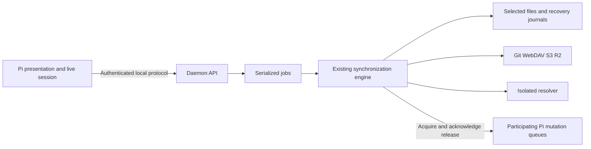

# Ownership and safety contract

This package owns the existing Pi Sync engine and a root-bound local service. Process lifetime is not permission to transfer files or invoke a model. The current implementation is under development; this document does not establish release readiness.

## Boundaries

`src/index.ts` exposes the lightweight IPC client, wire types, and hashes. It must not import the service, backend, watcher, or model runtime. `src/engine-service.ts` dispatches a closed operation set. `src/engine/host.ts` defines the engine's process boundary. The daemon never imports another extension or loads user extensions.

The exact unscoped `sync-daemon` name applies to a non-extension package; the repository's extension naming and `pi.extensions` requirements do not apply to it. The Pi client retains its own UI, commands, and status protocol.

## Authoritative documents

| Document | Writer | Coordination and recovery |
| --- | --- | --- |
| `pi-sync.json` and compatible legacy configuration | Daemon settings writer | Existing complete read/validate/update queue, cross-process config lock, private same-directory replacement, exact source identity/bytes check |
| `settings.json` selected by synchronization | Daemon apply transaction; Pi core remains an independent writer | Participating public file queues plus the actual Pi settings-file lock; revalidate preimages inside ownership |
| Selected settings/resources/sessions | Daemon apply transaction; tools/editors remain independent writers | Public client queue reservations, protected-session union, original preimages/backups/journals |
| `pi-sync/`, legacy `.pisync/` | Existing engine state writer in daemon | Existing operation lock, explicit migration guard, journal recovery; no automatic destructive migration |
| IPC identity/client ledger | Local server | Private root-bound namespace; atomic identity publication; ambiguous live sessions survive restart |
| `pi-sync/daemon.json` | Daemon consent owner | Bounded private atomic publication in one event-loop turn; exact policy/config/binding checks after review; interactive binding changes durably revoke prior unattended grants |
| `auth.json`, `models.json` | Public Pi SDK APIs only | No private credential parsing or parent credential copying; settle SDK credential writes before exit |

Read-only display state is not a second settings writer. A client proposes a validated new document with the exact source fingerprint; the authoritative writer checks the fingerprint under its settings lock. A stale editor must reopen rather than merge a stale approval automatically. Invalid existing JSON remains intact. Unknown fields remain in the proposed source clone.

## Context inventory

| Former Pi dependency | Engine host boundary | Source |
| --- | --- | --- |
| `getAgentDir()` | Explicit canonical service root | `engine/host.ts`, `engine/snapshot/session-paths.ts` |
| `ctx.cwd`, session directory/current session | Plain client facts, generation-bound getters | `protocol.ts`, `service-host.ts` |
| `ctx.isIdle()` | Current participating-client facts, not a captured Pi context | `service-host.ts` |
| `ctx.ui.notify`, status | Bounded events | `server.ts`, `service-host.ts` |
| Confirm/select/exact merge review | Job-bound callbacks; revalidation after response | `service-host.ts`, `engine/ui/merge-review.ts` |
| Reload | Explicit client callback after the existing user confirmation | `engine/sync/sync-mutations.ts` |
| `ctx.model`, `modelRegistry.streamSimple` | Explicit selected model identity/signature; independent public SDK runtime | `model-signature.ts`, `resolver-host.ts` |
| `withFileMutationQueue` | Participating Pi queue grants plus daemon-local queue | `service-host.ts`, Pi adapter `daemon/apply-gate.ts` |

Terminal formatting utilities are not interactive components. No daemon-owned menu, editor, or Pi custom UI is permitted. Exact review content stays data until the client renders it with its original UI and sanitization rules.

## Decision and failure matrix

| Branch/equivalence class | Required outcome | Verification |
| --- | --- | --- |
| First client / simultaneous clients | Canonical root startup lock; one lifetime owner; readiness identity matches version/root/instance | Process singleton tests |
| Distinct canonical roots / root aliases | Independent owners / same canonical owner | Server and process tests |
| Existing healthy identity | Connect; do not spawn | Handshake tests |
| Existing live but unreachable owner | Refuse a second owner | Startup failure tests |
| Dead known owner / another instance endpoint / replaced endpoint or ancestor | Use a fresh private instance namespace / leave old entries intact / retire the current namespace and retain unknown entries before Node closes | Endpoint tests |
| Incompatible version/root/instance/token | Reject before any operation | Protocol tests |
| Same operation ID, identical input | Return existing result; never redispatch | Replay tests |
| Same ID, changed input / expired result | Refuse; reconcile existing journal | Replay/eviction tests |
| Cancel before submit / queued / waiting for review | Tombstone / abort before dispatch / abort UI callback | Cancellation tests |
| Cancel or detach after commit | Finish existing journal/publication bookkeeping, not a second publication | Recovery tests |
| Active sessions in two clients | Protect their union, including alternate session roots | Multi-client apply tests |
| Lost connection with live PID / timeout | Retain protection and queue uncertainty; not proof of exit | Ambiguous-disconnection tests |
| Confirmed daemon exit | Release quarantined Pi grants only after ESRCH | Apply-gate tests |
| Busy participating client / changed generation | Stop or refuse automatic work; invalidate stale approval | Lifecycle tests |
| Pi edit/write during apply | Hold the actual public Pi queue; recheck preimages | Real `createEditTool` race test |
| Pi core settings update, existing file | Share its `proper-lockfile` file lock | Settings writer race tests |
| Missing `settings.json` with a live Pi | Refuse creation; Pi's missing-file branch does not reread after lock | Missing-settings contract test |
| Arbitrary unregistered writer | Existing optimistic checks only; no universal filesystem CAS claim | Existing snapshot race suites and documented limitation |
| No authorized model / parent-only provider | Resolver unavailable; no fallback model or extension loading | Resolver-host tests |
| Different serialized model definition, including key order | Resolver unavailable; preserve conflict and legacy request-budget identity | Signature and provider tests |
| Missing independent credentials | Public SDK failure; no parent-runtime key extraction | Synthetic resolver tests |
| No resolver request / cancellation after credential runtime creation | Metadata uses memory credentials without auth refresh / settle already-started SDK credential writes before releasing owner | Resolver lifecycle tests |
| Model output / stale candidate / refusal | Candidate only / revalidate all evidence / retain budget and refusal policy | Existing agent suites |
| Last Pi exit without reviewed daemon-era permission | Service may stay alive; no unattended transfer or inference | Zero-client tests |
| Print/JSON, no existing service / existing service | No launch / passive protection and automatic-work pause; never an implicit unattended grant | Bootstrap and actual-session-facts tests |
| Orderly exit / ambiguous disconnection / replacement handoff | Retain live-PID file protection without active participation / pause and retain protection / require matching published successor | Server, handoff, and native post-exit model tests |
| Config/model/consent changes during unattended review | Reject before publication, preserving new data | Consent tests |
| Interactive model/cwd/session-root changes after grant | Durably revoke older grants; reverting or restarting does not restore permission | Consent restart tests |
| Legacy continuous/agent options Off | Remain Off; service lifetime does not change policy | Policy regression suites |

The source-linked matrix is the audit contract, not a list of already completed checks. The implementation plan records actual results separately.

## Cross-process apply protocol

Acquire target queues in deterministic client-ID and canonical-target order. Each reservation has a job-bound ID and the peer's session generation. The client holds Pi's public queues until the daemon acknowledges completion with a `queue-release` callback. Release uses the reservation ID even if the grant response was lost. A cancelled UI callback does not release an acquired grant. If IPC disappears, hold the grant until explicit release or proof that its daemon process exited. A timeout is not such proof.

Batch reservations cover the transaction, not only each rename. Nested writes retain the transaction's queue ownership. Validate paths and canonical parents before reservation and recheck session protection and preimages after every await that can change them. The daemon's own Pi queue alone is insufficient.

Pi core's settings storage has separate existing-file and missing-file branches (`FileSettingsStorage.withLock()` in the installed SDK). Existing files lock before reading. Missing files compute the update before acquiring the file lock and do not reread afterward. Therefore creation with live Pi clients is refused, rather than claiming that the shared lock repairs this branch.

These guarantees cover cooperating registered clients. Unregistered old Pi versions, external editors, shell commands, and arbitrary extensions remain independent writers. Preserve conservative preimage checks, recovery evidence, and explicit upgrade preconditions.

## Native runtime boundaries

Each POSIX instance binds inside an exclusively created 0700 directory; this parent, not a post-bind pathname chmod, is the access boundary. Node/libuv unlinks its original Unix socket pathname even when a regular file or ancestor symlink replaced it. After jobs and release acknowledgements drain, move the instance directory entry into a private retained container before closing Node's listener. Delete only the recognized socket and empty owned directories. Keep unknown files/symlinks for recovery. If the namespace cannot be retired, retain the live closed-to-work owner and require a permissions repair and explicit stop retry.

The model signature hashes the exact existing JSON serialization. Equal hashes preserve the engine's existing candidate keys and Continuous configuration identity; a definition with different serialization is unavailable, not a reason to reset budgets. Static metadata uses an in-memory credential store and no refresh. Only an actual resolver transport creates the public SDK credential runtime. Its final public `transformHeaders` hook revalidates capability and evidence after auth awaits, without returning header values to Pi.

Unattended permission stores a setup/policy digest and an independent model/location binding, not a former Pi context. Normal closed clients remain in the protected-session ledger while their PID is alive but do not block zero-client scheduling; ambiguous losses and replacement gaps do. A consent publication failure latches automatic work off for that service instance; repair persistence and revoke the retained grant before an explicit restart.

The resolver uses independently available agent-root `auth.json`/`models.json` configuration and the environment captured at service start. Credential commands execute non-interactively from the canonical agent root, not from a former Pi working directory. Handover must disclose this provider/account boundary; changing the service environment requires a restart. Parent runtime accounts, registered providers, and conversations are not copied.

Persistent credential semantics remain those of the supported public SDK, including its path/lock assumptions; stop the service and drain Pi before relocating the agent root or replacing auth storage out of band. Do not claim a stronger credential-store filesystem CAS than the SDK provides.

## Legacy-process handover

An absent operation lock proves only that no observed transfer holds it, not that an idle old Pi process is absent. Before first daemon-owned mutation, require an explicit reviewed handover that instructs the operator to close or upgrade every old Pi process. Hold the existing operation lock while publishing the private root-bound handover record. Never silently fall back to the old engine. Existing operation locks still prevent competing observed transfers; older binaries cannot be made to honor a new marker retroactively.

Rollback requires explicit service stop and verified owner exit, preserved journals/backups, and closing all upgraded clients before running an older engine. Do not restore old settings bytes or downgrade over a pending/newer journal.

## Platforms

Use a private Unix-domain socket on POSIX and a root/user-bound named pipe on Windows. No TCP listener is needed. POSIX ownership, mode, and inode checks are testable on Linux. Native Windows ACL/process behavior and macOS terminal/logout behavior require native maintainer evidence before advertising new guarantees; retain the previous package's limitations explicitly in the migration record.
